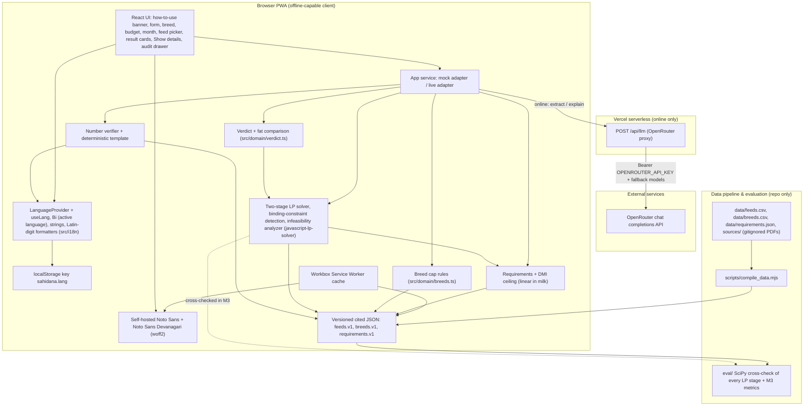
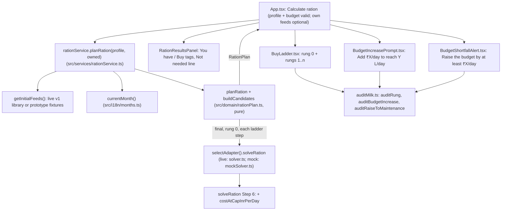
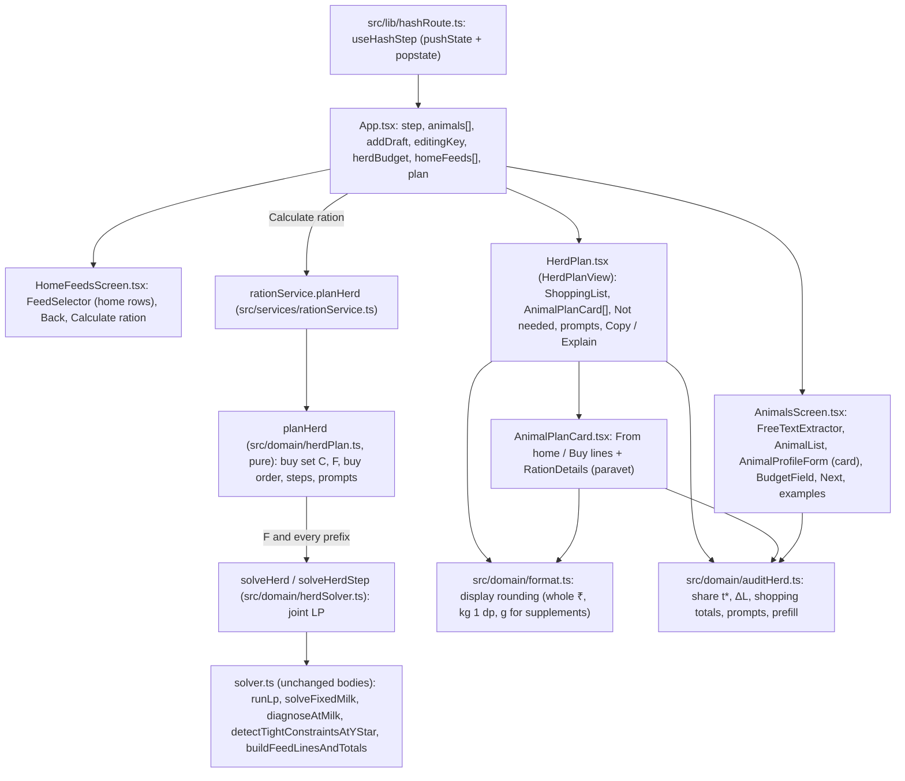

# SahiDana System Architecture

Technical foundation, component design, data models, API contracts and operational setup for SahiDana, realizing [SPEC.md](SPEC.md) (48 acceptance criteria), [FEEDBACK.md](FEEDBACK.md) (Rounds 1–4) and [PROJECT_MENTAL_MODEL.md](PROJECT_MENTAL_MODEL.md), with key choices recorded in [DECISIONS.md](DECISIONS.md). Last updated: 2026-10-12 (frozen after Round 4 prototype acceptance).

Status: FROZEN

## Overview

SahiDana is an offline-first progressive web app (PWA) for field paravets in Rajasthan and North India. The paravet enters an animal (species, breed, body weight, today's milk and fat), a daily budget and the feeds on hand. An in-browser two-stage linear program (LP) answers two questions: how much milk this budget can support with these feeds (never above the breed's cited milk cap, or today's milk if that is higher), with a cited minimum share of roughage, and the cheapest ration that supports it ([ADR-0007](DECISIONS.md#adr-0007-two-stage-budget-max-milk-lp)). The result leads with "This budget supports X L/day", a factual room-for-improvement verdict, and a tap-to-audit trail for every number. All calculation (requirements, dry-matter intake ceiling, both LP stages, verdicts, infeasibility diagnosis, the deterministic explanation template and the LLM number check) runs in the browser against versioned, Service-Worker-cached JSON compiled from cited sources: a Jaipur-area feed library in three verticals plus Mineral with season months and dated, editable prices ([ADR-0006](DECISIONS.md#adr-0006-regional-three-vertical-seasonal-library-with-cited-dated-editable-prices)), a breed table that sets the milk cap ([ADR-0008](DECISIONS.md#adr-0008-breed-based-milk-cap-body-weight-sets-intake-not-milk)), and the requirement tables. When online, the PWA talks to one stateless Vercel function (`/api/llm`) that proxies form extraction and plain-English explanation to OpenRouter and keeps `OPENROUTER_API_KEY` server-side. The UI shows one language at a time behind a Hindi/English toggle, English by default and remembered on the device ([ADR-0009](DECISIONS.md#adr-0009-language-toggle-one-language-per-screen)); numbers always stay in Latin digits. For Milestone 3 an offline Python suite in `eval/` re-solves every LP stage with SciPy to show that two independent solvers agree. Trade-offs and rejected alternatives are in [DECISIONS.md](DECISIONS.md).

## Technology stack

- **Frontend & client runtime:** TypeScript 5.x, React 18, Vite 5, Tailwind CSS 3, `vite-plugin-pwa` (Workbox precaching for offline use).
- **In-browser LP solver:** `javascript-lp-solver`, pure JavaScript simplex, synchronous, no WebAssembly ([ADR-0002](DECISIONS.md#adr-0002-in-browser-linear-programming-with-javascript-lp-solver)). It supports both `opType: 'max'` (stage 1) and `opType: 'min'` (stage 2) objectives, so the two-stage formulation needs no second library.
- **Hosting & serverless API proxy:** Vercel (static PWA plus one Node.js/TypeScript function at `api/llm.ts`; [ADR-0001](DECISIONS.md#adr-0001-static-pwa-plus-single-serverless-function-on-vercel), [ADR-0003](DECISIONS.md#adr-0003-server-side-openrouter-proxy-with-env-configured-model-fallback-chain)).
- **Language (Hindi or English, one at a time):** in-house typed strings module (`src/i18n/strings.ts`), a `LanguageProvider` with `useLang()`, and a `<Bi>` component that renders the active language only; no i18n library. Fonts self-hosted from npm: `@fontsource/noto-sans` and `@fontsource/noto-sans-devanagari` (SIL OFL-1.1, weights 400 and 600), precached by Workbox ([ADR-0009](DECISIONS.md#adr-0009-language-toggle-one-language-per-screen), [ADR-0005](DECISIONS.md#adr-0005-bilingual-side-by-side-ui) decisions 2, 3, 6).
- **Evaluation & solver cross-check (`eval/`, M3 only):** Python 3.11+ with `scipy` (`scipy.optimize.linprog`, HiGHS) and `pytest`.
- **Test runners:**
  - **Unit & integration (TypeScript):** Vitest with React Testing Library and `jsdom`.
  - **End-to-end & offline UI:** Playwright (`@playwright/test`), headless Chromium.
  - **Evaluation cross-check (M3):** `pytest`.

## Preview and screenshot commands

- **Preview command:** `npm run dev -- --port 5173`
  - **Local URL:** `http://localhost:5173`
- **Screenshot command:** `npx playwright screenshot --viewport-size="390,844" http://localhost:5173 docs/screenshots/mobile-preview.png`

## Test commands

Vitest is configured in `vite.config.ts` and Playwright in `playwright.config.ts`. Tests that launch a browser, build bundles or take more than 1 second live in `tests/e2e/` or are named `*.slow.test.ts`, so the fast suite stays under 15 seconds after every task.

- **Full:** `npm run test:full` (runs `npx vitest run && npx playwright test`)
- **Fast:** `npm test` (runs `vitest run --exclude "tests/e2e/**" --exclude "**/*.slow.test.ts"`)
- **One file:** `npx vitest run tests/unit/<module>.test.ts` (or `npx playwright test tests/e2e/<spec>.spec.ts` for E2E specs)

*(In M3, `python -m pytest -q eval/` runs the Python evaluation and the SciPy cross-check of every LP stage.)*

## Components



- **React UI (`src/components/`, `src/App.tsx`):** mobile-first workspace. At the top of the workspace (below the app bar, above the main inputs) sits a concise one-line **"How to use"** banner (`notice_how_to_use` in `src/i18n/strings.ts`, rendered via `<Bi>` in the active language; [FEEDBACK.md](FEEDBACK.md) Round 4 #1). Below it sit the animal form with `BreedSelect` (breeds filtered by species, with the cited benchmark), `BudgetField` (defaults to today's cost), `MonthSelector` and the feed picker grouped by vertical, `SupportedMilkCard` (headline), `VerdictCard` (verdict, fat line, caveat), the ration table, `DetailsToggle` for per-feed caps, coverage bars and the full audit, and the audit drawer. Every visible string goes through `<Bi>` or `bi()`; components contain no Devanagari literals.
- **Language layer (`src/i18n/`):** strings module, `LanguageProvider`/`useLang`, `<Bi>`, `bi()`/`biText()` plain-text helpers, `feedLabel()`/`breedLabel()` name pickers and the Latin-digit formatters (see [Language interface](#language-interface)).
- **Self-hosted fonts (`src/fonts.ts`):** Latin and Devanagari subsets, weights 400 and 600, precached.
- **App service (`src/services/rationService.ts`):** one `RationAppAdapter` interface; `mockAdapter.ts` for the prototype and tests, `liveAdapter.ts` (browser solver + `/api/llm` client) from M1.
- **Requirements & DMI ceiling (`src/domain/requirements.ts`):** turns species, body weight and fat into a linear requirement model: each of `CP`, `ME`, `Ca`, `P` is maintenance(body weight) + milk × per-litre(fat), and the dry-matter intake ceiling is NRC 2001 Eq. 1-1 written as intercept + slope × milk (see [LP formulation](#5-lp-formulation-two-stage)).
- **Breed rules (`src/domain/breeds.ts`):** the cap rules (cited peak first) and the effective cap `max(breed cap, T)`, `breedsForSpecies()`, and the benchmark shown under the breed field.
- **Two-stage LP solver (`src/domain/solver.ts`):** maintenance run, stage 1 (max milk), stage 2 (min cost at that milk), stage 2' (min cost at today's milk), binding-constraint detection, infeasibility and below-maintenance diagnosis.
- **Verdict (`src/domain/verdict.ts`):** pure function from `S`, `T`, cap, reference cost and the stage 2' result to the verdict union, plus the fat comparison.
- **Number verifier & template (`src/domain/verifier.ts`):** unchanged algorithm; the authorized-number set now includes `S`, `X`, `Z`, `B`, `M` and the cap.
- **Versioned cited JSON (`src/data/feeds.v1.json`, `src/data/breeds.v1.json`, `src/data/requirements.v1.json`):** compiled from `data/` and precached. The clickable prototype uses fixture files instead (`src/data/feeds.prototype.json` and, for Round 3, `src/data/breeds.prototype.json`), every value flagged `isPrototypeFixture`.
- **`POST /api/llm` (`api/llm.ts`):** stateless proxy with the model fallback chain.
- **Data pipeline & evaluation (`scripts/`, `eval/`):** compile script with validation, and the M3 SciPy cross-check and metrics.

## Data tasks and provenance workflow

The research hand-off for every value below is [DATA_SOURCES.md](DATA_SOURCES.md). Its rule applies to every table: **never invent a number**. A value that was not found leaves the cell empty, or (prices only) is labelled `team_estimate` with a stated reason.

1. **Source documents (`sources/`, gitignored):** the NDDB booklet (*Nutritive Value of Commonly Available Feeds and Fodders in India*, 2012), NDDB *Dairying in Rajasthan 2016*, *Dairying in Punjab 2014* and *Dairying in Gujarat 2013*, DAHD *Basic Animal Husbandry Statistics 2025*, and the NRC 2001 dairy chapter used for the intake equation. Copyrighted PDFs are never committed.
2. **Regional feed library (`data/feeds.csv` → `src/data/feeds.v1.json`):** about 30 Jaipur-area feeds in four groups (DATA_SOURCES §2–§4). UTF-8 without BOM. Columns:

   | Column | Content |
   |---|---|
   | `id` | unique slug, e.g. `wheat_straw` |
   | `english_name` | English name |
   | `local_name_latn`, `local_name_latn_citation`, `local_name_deva`, `local_name_deva_provenance` | local names exactly as the source gives them; rules unchanged (a team Devanagari spelling of a cited transliteration is `team-asserted`; no invented names) |
   | `vertical` | `indigenous_forage`, `crop_residue`, `agro_byproduct` or `mineral` |
   | `available_months` | months near Jaipur, as comma-separated numbers or ranges `a-b` with `a ≤ b`; a season across the new year is two ranges (`11-12,1-3`); `1-12` for stored feeds (DATA_SOURCES §3 seasonality model) |
   | `season_note_en`, `season_note_hi` | one short sentence shown on tap, e.g. "Rabi, irrigated; green Jan–Apr" (both languages, ADR-0009) |
   | `season_citation`, `season_provenance` | where the months come from; `cited` or `team-asserted` (DATA_SOURCES marks unofficial harvest windows) |
   | `dm_pct`, `cp_pct_dm`, `me_mcal_per_kg_dm`, `ca_g_per_kg_dm`, `p_g_per_kg_dm` | nutrients on a DM basis (NDDB) and DM% (Feedipedia) |
   | `source_doc`, `source_table`, `source_page`, `dm_source_citation` | nutrient citations; pages are printed pages (PDF page − 12) |
   | `provenance_status`, `nutrient_note` | `cited`, or `team-asserted` when a value is taken from a cited text range (e.g. pulse chuni CP 15–20); `nutrient_note` says which value was picked and why |
   | `default_price_inr_per_kg_as_fed` | number, or empty when no price was found |
   | `price_source`, `price_source_url`, `price_date` | source name, link, and `YYYY-MM-DD` |
   | `price_reliability` | `mandi`, `trade_report`, `listing` or `team_estimate` |
   | `price_note_en`, `price_note_hi` | unit conversion, range and pick rule, or the estimate's reason |
   | `verified_on` | date the row was checked against the primary document (human gate), empty until then |

   The old `category` and `availability_tag` columns are removed (see `FeedItem` below). Mustard straw is left out of v1: DATA_SOURCES §3 says feed it only to non-productive animals, and a max-milk tool should not offer it (SPEC OQ10).
3. **Price reliability rules:**
   - `mandi`: a data.gov.in mandi record. Date = arrival date; the modal ₹/quintal ÷ 100 gives ₹/kg; `price_note` names the market (e.g. Malpura).
   - `trade_report`: SEA, NCDEX or a dated news report. Date = report date; conversions (₹/MT ÷ 1000, ₹/q ÷ 100) go in `price_note`.
   - `listing`: an IndiaMART or TradeIndia listing, shown to the user as "indicative". Date = the listing date, or the date accessed for an undated listing (and `price_note` says "undated listing, date accessed"). When the listing gives a range, the default is the midpoint and the range goes in `price_note`.
   - `team_estimate`: allowed only with a reason in `price_note` that cites what the estimate is based on (for example a dated price from another district). The compile script rejects a `team_estimate` without a note.
   - **No price found:** all price columns stay empty. The feed shows an empty price field and the paravet must enter one (SPEC AC-3.2).
   - Every default price stays editable in the app; an edited price is labelled "your price" and replaces the default for that run only (AC-3.6). There is no live price API ([ADR-0006](DECISIONS.md#adr-0006-regional-three-vertical-seasonal-library-with-cited-dated-editable-prices)).
4. **Breed table (`data/breeds.csv` → `src/data/breeds.v1.json`):** the 14 breeds of DATA_SOURCES §5 (Bhadawari added in the OQ16 correction) plus one non-descript row per species. Breed Hindi names live here, not in the strings file. Columns:

   | Column | Content |
   |---|---|
   | `id`, `species` | slug (e.g. `murrah`, `nondescript_cattle`); `cow` or `buffalo` |
   | `english_name`, `local_name_latn`, `local_name_deva`, `local_name_deva_provenance` | names; the Devanagari spelling of a breed name is normally `team-asserted` and reviewed on 2026-10-14 |
   | `is_non_descript` | `true` for the two DAHD rows |
   | `female_body_weight_kg`, `body_weight_citation` | cited adult female weight, or empty. Display only: never used to set milk or intake |
   | `lactation_yield_kg`, `lactation_yield_low_kg`, `lactation_yield_high_kg` | cited lactation yield and its range, each empty when not cited (crossbreds have a range and no single value) |
   | `lactation_length_days`, `lactation_length_min_days` | cited length; when the source gives a range, `lactation_length_days` is the longer and `lactation_length_min_days` the shorter, otherwise both are the same value |
   | `avg_daily_yield_kg` | cited average daily ("wet") yield, or empty; for non-descript rows, the DAHD figure |
   | `peak_daily_yield_kg`, `peak_source_doc`, `peak_source_table`, `peak_source_page`, `peak_source_url` | cited peak daily yield, or empty. When the source gives a range of study means (e.g. Murrah 7.1–9.64 [BP]), the cell holds the upper cited value |
   | `peak_note_en`, `peak_note_hi` | required when the peak is the upper value of a range: states the range and that its upper value is used, e.g. "Upper value of reported study means 7.1–9.64 kg/day" |
   | `yield_source_doc`, `yield_source_table`, `yield_source_page`, `yield_source_url`, `yield_figure_year` | citation for the yield figures; `yield_figure_year` is required for DAHD rows (`2024-25` cattle, `2023-24` buffalo) |
   | `fat_pct_low`, `fat_pct_high`, `fat_source_doc`, `fat_source_table`, `fat_source_page`, `fat_source_url` | cited fat %; a single value fills both; all empty when not cited (Kankrej, crossbreds, non-descript) |
   | `verified_on` | date the row was checked against the primary document, empty until then |

   `cap_basis` and `milk_cap_l_per_day` are **not** CSV columns: the compile script computes them with the rules below, so nobody types a cap by hand.
5. **Nutrient requirements (`data/requirements.json` → `src/data/requirements.v1.json`):** maintenance by body weight (CELKAU/ICAR) and per-litre-of-milk by fat (ICAR 2013 or NASEM 2021, whichever is verified first; [ADR-0004](DECISIONS.md#adr-0004-nutrient-requirement-standard-and-cited-feed-data-provenance)), plus the intake-ceiling constants of NRC 2001 Eq. 1-1 (`0.372`, `0.0968`, `0.192`, `3.67`), the 4% fat-corrected-milk constants (`0.4`, `15`), the default week of lactation (`20`), and the **roughage minimum share** `roughageMinShareOfDm` (`r_min`), each with its citation:

   ```json
   "roughageMinShareOfDm": { "value": null, "citation": { "doc": "", "table": "", "page": "", "url": "" }, "note": "", "verifiedOn": null }
   ```

   `value` is the minimum fraction (0–1) of total ration dry matter that must come from roughage (feeds whose `vertical` is `indigenous_forage` or `crop_residue`). **The data task must find it in an ICAR or NDDB source** (for example ICAR 2013 *Nutrient Requirements of Cattle and Buffalo* or NDDB ration-balancing guidance) and record document, table or section, and page. **If no ICAR/NDDB citation is found, the data task stops and asks the user**; no value is typed in without a citation, and the code has no built-in default. The clickable prototype may use a fixture value only if it is flagged `isPrototypeFixture` like every other fixture.
6. **Compile script (`scripts/compile_data.mjs`):** reads the three sources, NFC-normalizes Devanagari, and fails the build when: a required column is empty; `vertical` or `price_reliability` is not in its enum; `available_months` does not parse to months 1–12; a default price has no reliability, date or source, or a reliability is set without a price; a `team_estimate` has no note; a `team-asserted` Devanagari name has no transliterated name; a breed matches none of the cap rules; a `peak_daily_yield_kg` has no peak citation; a non-descript row has no `yield_figure_year`; `roughageMinShareOfDm.value` is missing, outside `(0, 1)`, or has an empty citation `doc` or `page`. It prints a warning (not a failure) for every row whose `verified_on` is empty.
7. **Human verification gate (Teammate A, before M3 closes):** every row of `data/feeds.csv`, every row of `data/breeds.csv` (figures against [R], [P], [GJ], [G1], [BP], [S] in DATA_SOURCES §5, including each peak and, where a range of study means was given, that the upper value was taken), both DAHD non-descript figures (3.86 and 4.73 against the BAHS 2025 PDF, including the year of each), the requirement tables, the NRC 2001 Eq. 1-1 constants (DATA_SOURCES §5 warns to verify the constant against the original), and the roughage minimum share against its ICAR/NDDB source. Teammate A fills `verified_on` / `verifiedOn`. The M3 release check requires none empty. Tracked as a mandatory UAT checklist item.
8. **Hindi review gate (native-speaker teammate, Wed 2026-10-14):** every `hi` value in `src/i18n/strings.ts`, every `team-asserted` Devanagari feed and breed name (breed Hindi names live in `data/breeds.csv`, not the strings file), and every `season_note_hi`, `price_note_hi` and `peak_note_hi`. Until then `HINDI_REVIEW.status` is `'unverified'`. After the review the reviewer sets `status: 'verified'` with name and date and appends a dated review line under [ADR-0005](DECISIONS.md#adr-0005-bilingual-side-by-side-ui). Mandatory UAT checklist item.

## Data models

### 1. Animal profile (`AnimalProfile`)

| Field | Type | Validation rules |
|---|---|---|
| `species` | `'cow' \| 'buffalo'` | Required. |
| `breedId` | `string` | Required ("Select a breed", AC-E1.1). Must be the `id` of a `BreedStandard` with the same `species`. Cleared when the species changes. |
| `bodyWeightKg` | `number` | Required; finite, `[150, 800]`. Sets the requirements' maintenance part and the intake ceiling, never the milk cap. |
| `milkYieldLitersPerDay` | `number` | Required; finite, `[0, 40]`. This is today's milk `T`. |
| `milkFatPct` | `number \| null` | Finite, `[2.5, 10.0]`. Required when milk `> 0`. When milk is `0` (dry animal) it is optional and unused: a dry animal skips stage 1 and gets the maintenance ration (see LP formulation), and neither maintenance nor the intake ceiling at 0 L depends on fat. |
| `budgetInrPerDay` | `number \| null` | The budget passed to the solver, finite and `> 0`. Rule (AC-4.2, AC-4.3): the value the user typed, if they edited the budget; otherwise today's ration cost when today's ration is entered; otherwise `null`, and **Balance ration** is disabled with "Enter a daily budget". Whether the user has edited it is form state (`budgetEdited`), not part of this type. |
| `isConfirmed` | `boolean` | Must be `true` before balancing; `false` after LLM prefill until the user confirms. |

### 2. Cited feed library item (`FeedItem`)

| Field | Type | Validation rules |
|---|---|---|
| `id` | `string` | Unique slug. |
| `englishName` | `string` | Non-empty. |
| `localNameLatn` | `string \| null` | Transliterated local name(s) as the source gives them, alternatives separated by `' / '`. |
| `localNameLatnCitation` | `string \| null` | Non-null iff `localNameLatn` or a `cited` `localNameDeva` is non-null. |
| `localNameDeva` | `string \| null` | NFC-normalized Devanagari name; never invented. |
| `localNameDevaProvenance` | `'cited' \| 'team-asserted' \| null` | Non-null iff `localNameDeva` is non-null; `team-asserted` requires `localNameLatn`. |
| `vertical` | `'indigenous_forage' \| 'crop_residue' \| 'agro_byproduct' \| 'mineral'` | Required. Sets the picker group (AC-3.3); each feed is in exactly one group. |
| `availableMonths` | `number[]` | Sorted, unique integers `1`–`12`, non-empty. `[1..12]` for stored feeds. Drives the "in season" mark only (AC-3.4); never a solver input. |
| `seasonNote` | `BiText` (`{ hi: string; en: string }`) | Both halves non-empty; shown on tap for an out-of-season feed (AC-3.5). A pair rather than a single string because it is team-written prose shown in either language (ADR-0009). |
| `seasonCitation` | `string` | Source of the months (e.g. ICAR-CRIDA Jaipur contingency plan; RAJFED purchase guidelines). |
| `seasonProvenance` | `'cited' \| 'team-asserted'` | `team-asserted` when the months are not from an official calendar. |
| `dmPct` | `number` | DM % as fed, `(0, 100]`. |
| `cpPctDm` | `number` | CP % of DM, `[0, 100]` (`1 % = 10 g/kg DM`). |
| `meMcalPerKgDm` | `number` | ME Mcal/kg DM, `[0, 10]`. |
| `caGramsPerKgDm` | `number` | Ca g/kg DM, `[0, 500]`. |
| `pGramsPerKgDm` | `number` | P g/kg DM, `[0, 500]`. |
| `derivedTdnPctDm` | `number` | Display only, `ME × 27.7`, labelled `derived`. |
| `sourceDoc`, `sourceTable`, `sourcePage` | `string` | Nutrient citation (printed page). |
| `dmSourceCitation` | `string` | DM% citation (Feedipedia node). |
| `provenanceStatus` | `'cited' \| 'team-asserted'` | Now scoped to the nutrient values: `team-asserted` when a value is picked from a cited range. |
| `nutrientNote` | `string \| null` | Required when `provenanceStatus` is `team-asserted`. |
| `defaultPriceInrPerKgAsFed` | `number \| null` | `>= 0`, or `null` when no price was found (empty price field, AC-3.2). |
| `priceSource` | `string \| null` | Source name (exempt from the one-language rule as a source name). Non-null iff a default price exists. |
| `priceSourceUrl` | `string \| null` | Link, when the source has one. |
| `priceDate` | `string \| null` | `YYYY-MM-DD`; non-null iff a default price exists. |
| `priceReliability` | `'mandi' \| 'trade_report' \| 'listing' \| 'team_estimate' \| null` | Non-null iff a default price exists. Labels (AC-3.6): "mandi", "trade report", "indicative", "team estimate". |
| `priceNote` | `BiText \| null` | Required (non-null) for `team_estimate`; optional otherwise. |
| `verifiedOn` | `string \| null` | Human-gate date, `YYYY-MM-DD`. |

**`category` is removed; roughage and row chip styling are derived from `vertical` (prototype alignment #1).** `category` (`FeedCategory`) and `availabilityTag` were kept on `FeedItem` in `src/domain/types.ts` and `src/data/feeds.prototype.json` during the prototype only for row chip classes (`CATEGORY_CLASS` in `src/domain/feedNames.ts`). In the frozen contract and `data/feeds.csv` → `src/data/feeds.v1.json`, `category` and `availabilityTag` are removed from `FeedItem`:
- Roughage classification is a pure function of `vertical`: `isRoughage(feed) = feed.vertical === 'indigenous_forage' || feed.vertical === 'crop_residue'` (in `src/domain/nutrition.ts`). `agro_byproduct` and `mineral` feeds are non-roughage. Keeping a separate `category` would store the same classification twice and allow them to disagree ([ADR-0006](DECISIONS.md#adr-0006-regional-three-vertical-seasonal-library-with-cited-dated-editable-prices), [ADR-0007](DECISIONS.md#adr-0007-two-stage-budget-max-milk-lp)).
- Row chip styling in `src/domain/feedNames.ts` moves from `CATEGORY_CLASS: Record<FeedCategory, string>` to `VERTICAL_CLASS: Record<FeedVertical, string>` in M1 when `feeds.v1.json` replaces `feeds.prototype.json`.

### 3. Breed standard (`BreedStandard`)

Compiled from `data/breeds.csv` into `src/data/breeds.v1.json` by `scripts/compile_data.mjs`.

| Field | Type | Validation rules |
|---|---|---|
| `id` | `string` | Unique slug. |
| `species` | `'cow' \| 'buffalo'` | Required. |
| `englishName` | `string` | Non-empty, e.g. `'Murrah'`, `'Non-descript'`. |
| `localNameLatn` | `string \| null` | Alternative names as cited, or `null`. |
| `localNameDeva` | `string \| null` | Hindi display name (NFC). |
| `localNameDevaProvenance` | `'cited' \| 'team-asserted' \| null` | Non-null iff `localNameDeva` is non-null. |
| `isNonDescript` | `boolean` | Exactly one `true` row per species. |
| `femaleBodyWeightKg` | `number \| null` | Cited weight, display only (audit sheet). |
| `lactationYieldKg` | `number \| null` | Cited lactation yield. |
| `lactationYieldLowKg`, `lactationYieldHighKg` | `number \| null` | Cited range; both or neither. |
| `lactationLengthDays` | `number \| null` | Cited length (the longer, when a range). |
| `lactationLengthMinDays` | `number \| null` | The shorter cited length; equals `lactationLengthDays` when the source gives one value. |
| `avgDailyYieldKg` | `number \| null` | Cited average daily yield; for non-descript rows, the DAHD figure. |
| `peakDailyYieldKg` | `number \| null` | Cited peak daily yield; the upper cited value when the source gives a range of study means. |
| `peakCitation` | `Citation \| null` | Non-null iff `peakDailyYieldKg` is non-null. |
| `peakNote` | `BiText \| null` | Required when the peak is the upper value of a cited range; shown in the audit sheet. |
| `fatPctLow`, `fatPctHigh` | `number \| null` | Cited fat % (single value: both equal); both `null` when not cited, and the UI says "breed fat %: not cited" (AC-5.10). |
| `capBasis` | `'cited_peak' \| 'range_top' \| 'breed_average' \| 'breed_average_calc' \| 'dahd_average'` | Computed. |
| `milkCapLPerDay` | `number` | Computed, rounded to 2 decimals. The solver uses this stored value, so the number shown is the number used. |
| `yieldCitation` | `Citation` | `{ doc, table, page, url, year }` (`year` required for DAHD). |
| `fatCitation` | `Citation \| null` | Non-null iff fat is cited. |
| `bodyWeightCitation` | `Citation \| null` | Non-null iff `femaleBodyWeightKg` is non-null. |
| `verifiedOn` | `string \| null` | Human-gate date. |

**Cap rules** (FEEDBACK Round 3, architecture review decisions: cited peak first, then the SPEC "Shared definitions" rules; applied in this order; implemented once in `src/domain/breeds.ts` and called by the compile script and by a unit test that recomputes every stored cap):

| Order | When | `milkCapLPerDay` | `capBasis` | Benchmark label |
|---|---|---|---|---|
| 1 | `isNonDescript` | `avgDailyYieldKg` (DAHD: cattle `3.86`, 2024-25; buffalo `4.73`, 2023-24; pending verification) | `dahd_average` | "national average (DAHD)" |
| 2 | `peakDailyYieldKg` is set | `peakDailyYieldKg` | `cited_peak` | "cited peak daily yield" |
| 3 | `lactationYieldHighKg` is set | `lactationYieldHighKg ÷ lactationLengthMinDays` (the top of the yield range over the shorter cited length; for single-length breeds the shorter length is the length) | `range_top` | "lactation average (no peak cited)" |
| 4 | `avgDailyYieldKg` is set | `avgDailyYieldKg` | `breed_average` | "lactation average (no peak cited)" |
| 5 | `lactationYieldKg` and `lactationLengthDays` are set | `lactationYieldKg ÷ lactationLengthDays` | `breed_average_calc` | "lactation average (no peak cited)" |

The non-descript rule sits first only because those rows have no breed figures; among breeds, `cited_peak` is the first rule. For rules 3–5 the audit sheet also names the exact rule ("range top", "breed average", "breed average (calc)") and shows the division.

**Cap table** (DATA_SOURCES §5 figures, all pending the human gate):

| Breed | Species | Cap L/day | `capBasis` | From |
|---|---|---|---|---|
| Murrah | buffalo | 9.64 | `cited_peak` | [BP] peak 7.1–9.64 is a range of study means; its top, 9.64, is used (stated in `peakNote`) |
| Nili-Ravi | buffalo | 9.40 | `cited_peak` | [BP] peak 9.4 is the cited mean; 7.2–11.8 is the range across individual animals and is not used |
| Bhadawari | buffalo | 6.93 | `cited_peak` | [BP] peak 6.93 (lactation 1,232 kg / 291 days, IGFRI herd; fat 8.09%, individual range 5.5–14 not used) |
| Sahiwal | cattle | 11.15 | `cited_peak` | [S] Pantnagar Sahiwal study, peak 11.15 |
| Rathi | cattle | 8.36 | `range_top` | [R] 2,810 ÷ 336 |
| Tharparkar | cattle | 7.53 | `range_top` | [R] 2,147 ÷ 285 |
| Nagori | cattle | 3.39 | `range_top` | [R] 905 ÷ 267 |
| Hariana | cattle | 6.45 | `range_top` | [P] 1,754 ÷ 272 |
| HF crossbred | cattle | 14.64 | `range_top` | [P] 4,568 ÷ 312 (shorter length) |
| Jersey crossbred | cattle | 10.70 | `range_top` | [P] 3,476 ÷ 325 (shorter length) |
| Gir | cattle | 6.33 | `breed_average_calc` | [G1]/[GJ] 2,063 ÷ 326 |
| Kankrej | cattle | 6.22 | `breed_average_calc` | [GJ] 1,954 ÷ 314 |
| Surti | buffalo | 5.48 | `breed_average_calc` | [GJ] 1,699 ÷ 310 |
| Mehsana | buffalo | 5.84 | `breed_average_calc` | [GJ] 1,840 ÷ 315 |
| Non-descript | cattle | 3.86 | `dahd_average` | DAHD BAHS, 2024-25 |
| Non-descript | buffalo | 4.73 | `dahd_average` | DAHD BAHS, 2023-24 |

Rule for ranges: a peak given as a range of **study means** uses its top (Murrah). A peak given as a single mean with a range across **individual animals** uses the mean (Nili-Ravi); individual extremes are never used as a cap. Fat follows the same rule (Bhadawari 8.09). Bhadawari was added to DATA_SOURCES §5 in the OQ16 correction; it is in the breed list because AC-2.4 lists "exactly the breeds of DATA_SOURCES §5". `data/breeds.csv` stays the authority after the human check.

**Effective cap.** The breed cap above is a cited benchmark, not a limit on a real animal that already gives more. Stage 1 therefore uses the **effective cap** $\bar{Y}_{\text{eff}} = \max(\bar{Y}, T)$ (FEEDBACK Round 3, OQ15). When $T > \bar{Y}$, the audit shows both numbers and the line "today's milk is higher, so it is used as the cap". `RationSolution` records the breed cap and the effective cap separately.

**1 kg of milk ≈ 1 L.** Breed sources report milk in kg; the app uses the kg figure as litres without conversion. Every audit sheet that shows a breed figure (cap, peak, lactation yield, average) carries the line "1 kg of milk ≈ 1 L (assumption)" (AC-2.4, AC-2.5). The intake equation (NRC 2001) also takes milk in kg and uses the same assumption.

`femaleBodyWeightKg` is never used in a calculation: no cited standard predicts milk from body weight, and the animal's own entered weight sets intake ([ADR-0008](DECISIONS.md#adr-0008-breed-based-milk-cap-body-weight-sets-intake-not-milk)).

### 4. Selected feed input (`SelectedFeedInput`)

| Field | Type | Validation rules |
|---|---|---|
| `feedId` | `string` | Must exist in `feeds.v1.json`. |
| `priceInrPerKgAsFed` | `number` | Required; finite, `>= 0` (the default or the user's price). |
| `maxKgAsFedPerDay` | `number \| null` | Optional cap behind **Show details**; finite, `>= 0`. |
| `currentKgAsFedPerDay` | `number \| null` | Optional "today's ration"; finite, `>= 0`. |

The month selector value and the "your price" label are UI state; neither reaches the solver.

### 5. LP formulation (two-stage)

**Notation.** For selected feed $i \in \{1,\dots,k\}$: $x_i \ge 0$ is kg/day **as fed**, $d_i = \text{dmPct}_i/100$, $p_i$ the price (₹/kg as fed), $u_i$ the optional cap. Nutrient supply per kg as fed:
$a_{\text{CP},i} = 10\,\text{cpPctDm}_i\,d_i$ (g), $a_{\text{ME},i} = \text{meMcalPerKgDm}_i\,d_i$ (Mcal), $a_{\text{Ca},i} = \text{caGramsPerKgDm}_i\,d_i$ (g), $a_{\text{P},i} = \text{pGramsPerKgDm}_i\,d_i$ (g).
$Y$ is milk in L/day. $\bar{Y}$ is the breed's `milkCapLPerDay`; $T$ is today's milk; $\bar{Y}_{\text{eff}} = \max(\bar{Y}, T)$ is the effective cap. $W$ is body weight (kg) and $f$ the entered fat % (a dry animal never reaches a stage that uses $f$). $\mathcal{R} = \{\, i : \text{vertical}_i \in \{\texttt{indigenous\_forage}, \texttt{crop\_residue}\} \,\}$ is the set of selected roughage feeds, and $r$ is `roughageMinShareOfDm` from `requirements.v1.json` (cited, ICAR/NDDB).

**Requirements are linear in milk.** For $n \in \{\text{CP}, \text{ME}, \text{Ca}, \text{P}\}$:
$$\text{req}_n(Y) = m_n(W) + \ell_n(f)\,Y$$
where $m_n(W)$ is the maintenance requirement from the CELKAU/ICAR table and $\ell_n(f)$ the per-litre requirement at fat $f$ (ICAR 2013 or NASEM 2021, ADR-0004). Both are computed **before** solving from the inputs, so they are constants in the LP.

**Dry-matter intake ceiling, linear in milk.** NRC 2001 *Nutrient Requirements of Dairy Cattle*, 7th rev. ed., Chapter 1, Eq. 1-1:
$$\text{DMI} = \left(0.372\,\text{FCM} + 0.0968\,W^{0.75}\right)\left(1 - e^{-0.192\,(\text{WOL} + 3.67)}\right)$$
with 4% fat-corrected milk $\text{FCM} = 0.4\,Y + 15\,(f/100)\,Y = (0.4 + 0.15 f)\,Y$ (NRC 2001, same chapter; milk in kg, used as L by the 1 kg ≈ 1 L assumption). The form does not collect week of lactation (SPEC OQ9), so **WOL is fixed at 20** (mid-lactation of a roughly 300-day lactation), giving the lag factor $\lambda = 1 - e^{-0.192 \times 23.67} \approx 0.9894$. Then
$$\text{DM}_{\max}(Y) = k_0 + k_Y\,Y,\qquad k_0 = 0.0968\,\lambda\,W^{0.75},\qquad k_Y = 0.372\,\lambda\,(0.4 + 0.15 f)$$
$W^{0.75}$ is computed once from the entered body weight and enters only through the constant $k_0$; $f$ enters only through the constant $k_Y$. Worked check: a 450 kg buffalo at 6.5% fat gives $k_0 \approx 9.36$ kg and $k_Y \approx 0.506$ kg per L, so 8 L/day allows about 13.4 kg DM (3.0% of body weight). The audit drawer shows the equation, WOL = 20, $\lambda$, $W^{0.75}$ and the result. **Warning:** the constants come from a secondary quotation (DATA_SOURCES §5, "verify the constant against the original"); Teammate A verifies all four constants and the FCM formula at the human gate before M3. NRC 2001 was fitted on Holstein cows; using it for zebu cattle and buffalo, and at $Y = 0$ for dry animals, is an extrapolation stated in [ADR-0008](DECISIONS.md#adr-0008-breed-based-milk-cap-body-weight-sets-intake-not-milk).

**Roughage minimum, linear** (FEEDBACK Round 3 architecture decisions). Roughage dry matter must be at least the cited share $r$ of total ration dry matter (all selected feeds, including agro-byproducts and mineral):
$$\sum_{i \in \mathcal{R}} d_i\,x_i \ \ge\ r \sum_{i} d_i\,x_i$$
Moving everything to the left gives a homogeneous constant-coefficient row:
$$\sum_{i \in \mathcal{R}} (1 - r)\,d_i\,x_i \;-\; \sum_{i \notin \mathcal{R}} r\,d_i\,x_i \ \ge\ 0 \qquad\text{(roughage row, written } \rho(x) \ge 0\text{)}$$
It applies in **every** run below (maintenance, stage 1, both stage 2 runs, stage 2', the AC-E7.1 re-runs and the AC-E2.1 diagnosis). It is homogeneous, so it keeps the feasible set convex and keeps $x = 0$ admissible; the rounding-down argument below still holds. The audit drawer shows $r$ with its citation and the roughage share achieved. If no roughage feed is selected, every ration with positive dry matter breaks the row, which the diagnosis reports as "roughage".

**No dry-matter floor (prototype alignment #2: `DM_FLOOR_FRACTION` is prototype-only).** The prototype's `src/services/mockSolver.ts` included an ad-hoc lower bound $\sum_i d_i x_i \ge 0.85\,\text{DM}_{\max}(Y)$ (`DM_FLOOR_FRACTION = 0.85`). The frozen LP formulation (`src/domain/solver.ts` and `eval/cross_check_solver.py`) has **no** DM floor:
- Per SPEC OQ13, total DM is bounded above by the NRC 2001 intake ceiling ($\sum_i d_i x_i \le \text{DM}_{\max}(Y)$), while `CP`, `ME`, `Ca` and `P` are positive minimums ($m_n + \ell_n Y > 0$ for all $Y \ge 0$) that already force positive dry-matter intake, and the homogeneous roughage row $\rho(x) \ge 0$ (SPEC AC-5.12) enforces the cited minimum roughage share of total DM.
- No ICAR, NDDB, NRC or NASEM standard specifies an 85% DM floor; keeping an uncited floor would violate the "never invent a number" rule and could cause false infeasibility when nutrient-dense feeds satisfy all requirements below 85% of the intake ceiling.
- Roughage infeasibility diagnosis in `src/domain/solver.ts` (Step 1 below) therefore does not divide by `0.85 × dmMax`: it solves the maintenance LP with vs. without $\rho(x) \ge 0$ (and checks capped roughage supply against the minimum DM required to meet `CP`, `ME`, `Ca`, `P`).

**Why everything stays linear.** The only decision variables are $x_1,\dots,x_k$ and $Y$. Every non-linear term ($W^{0.75}$, the exponential lag factor, the fat-dependent per-litre requirement, the maintenance lookup) depends only on inputs and is evaluated to a number before the LP is built; $r$ is a constant from data. Every constraint and objective is therefore a constant-coefficient linear expression in $(x, Y)$. Fat is an input, never a variable; making it a variable would create the bilinear term $f \cdot Y$.

**Maintenance run** (gives $M$; no budget):
$$M = \min_x \sum_i p_i x_i \quad\text{s.t.}\quad \sum_i a_{n,i}x_i \ge m_n\ \ \forall n,\qquad \sum_i d_i x_i \le k_0,\qquad \rho(x) \ge 0,\qquad 0 \le x_i \le u_i$$

**Stage 1** (most milk the budget supports):
$$\max_{x,\,Y}\ Y$$
$$\text{s.t.}\quad \sum_i a_{n,i}\,x_i - \ell_n\,Y \ \ge\ m_n \qquad \forall n \in \{\text{CP},\text{ME},\text{Ca},\text{P}\}$$
$$\sum_i d_i\,x_i - k_Y\,Y \ \le\ k_0 \qquad\text{(intake ceiling)}$$
$$\rho(x) \ \ge\ 0 \qquad\text{(roughage minimum)}$$
$$\sum_i p_i\,x_i \ \le\ \text{budget}$$
$$0 \le Y \le \bar{Y}_{\text{eff}} = \max(\bar{Y}, T),\qquad 0 \le x_i \le u_i \ \ (\text{when } u_i \text{ is set})$$
The optimum is $Y^*$. Because $\bar{Y}_{\text{eff}} \ge T$, stage 1 can only end below today's milk when the budget, the feeds (intake, roughage, nutrients, feed limits) stop it, never because of the breed figure.

**Stage 2** (cheapest ration at a fixed milk level $y$):
$$\min_x \sum_i p_i\,x_i \quad\text{s.t.}\quad \sum_i a_{n,i}\,x_i \ge m_n + \ell_n\,y\ \ \forall n,\qquad \sum_i d_i\,x_i \le k_0 + k_Y\,y,\qquad \rho(x) \ge 0,\qquad \sum_i p_i\,x_i \le \text{budget},\qquad 0 \le x_i \le u_i$$
Stage 2 runs twice:
- **at $y = Y^*$**, only to detect the binding constraint (below); and
- **at $y = S$**, the displayed ration (AC-5.1, AC-6.2 "stage 2 at `S`").

**Tolerance between the stages.** $S = \lfloor 10\,Y^* + 10^{-7} \rfloor / 10$: $Y^*$ **rounded down** to 0.1 L. Rounding down is the tolerance: the feasible set in $(x, Y)$ is convex and contains both $(x_M, 0)$ and $(x^*, Y^*)$, so every milk level between 0 and $Y^*$ is feasible within the budget, and stage 2 at $S \le Y^*$ cannot fail. It also keeps $S \le \bar{Y}_{\text{eff}}$ on screen (rounding 3.86 to nearest would show 3.9 above a 3.86 cap). The $10^{-7}$ absorbs float noise such as $Y^* = 6.0999999$; if that ever makes $S$ exceed $Y^*$ by more than the solver tolerance and stage 2 reports infeasible, the solver retries once at $S - 0.1$. When $S = Y^*$ within $10^{-6}$, the two stage 2 runs are the same run.

**Stage 2'** (cheapest ration at today's milk $T$; no budget, no cap): stage 2 with $y = T$ and the budget row removed (the roughage row stays). It gives `costAtTodayMilkInrPerDay`, used as $B$ (AC-5.11) and for $Z$ = reference cost − that cost (AC-5.7). It runs only when $T > 0$ and either $Y^* < T - 10^{-6}$ or $T \ge \bar{Y}$ (comparisons use the unrounded $Y^*$, see Verdict selection). If it is infeasible, the limiting constraints at $T$ are found with the same diagnosis as AC-E2.1, $B$ is `null`, and **no saving is shown** ($Z$ is `null`).

**Dry animal ($T = 0$).** Stage 1, stage 2 and stage 2' are skipped. The displayed ration is the maintenance run's ration (cheapest ration at 0 L), $S = 0$, and the verdict is `dry_maintenance` ("Dry animal: maintenance ration"). Steps 1 and 2 below still apply, so an infeasible selection or a budget below $M$ is reported exactly as for a milking animal. There is no binding constraint, no fat line, and fat is not needed.

**Order of runs in `solveRation`:**
1. Maintenance run. Infeasible → `InfeasibilityReport` (AC-E2.1, AC-E2.2). Diagnosis, with feed caps and $\sum_i d_i x_i \le k_0$ in every LP:
   - for each nutrient, a max-supply LP ($\max \sum_i a_{n,i}x_i$, **without** the roughage row) compared with $m_n$; nutrients that fall short are named;
   - if no roughage feeds are selected ($\mathcal{R} = \emptyset$) or if repeating the maintenance run **without** the roughage row $\rho(x) \ge 0$ is feasible, the report names `roughage` (AC-E2.2: the selected feeds cannot meet the requirements with at least the share $r$ of roughage DM);
   - otherwise the report is a "DM intake conflict".

   Suggested feeds: for a nutrient, the unselected library feed with the most of it per kg DM; for `roughage`, the unselected roughage feed (`indigenous_forage` or `crop_residue`) with a default price (`defaultPriceInrPerKgAsFed !== null`) and the lowest price per kg DM (AC-E2.2). No ration, no `S`, no verdict.
2. If $\text{budget} < M - 10^{-6}$ → `BudgetBelowMaintenanceReport` (AC-E7.1). Only unselected library feeds **with a default price** are tried: the maintenance run is repeated with each one added (default price, no cap); the feed with the lowest resulting $M'$ that is $\le$ budget is named (ties: library order), or `fixFeed: null` when none qualifies. Feeds with no default price are never suggested. No ration, no `S`.
3. If $T = 0$: dry animal (above); stop.
4. Stage 1. It is always feasible here ($Y = 0$ at cost $M \le$ budget) and bounded ($Y \le \bar{Y}_{\text{eff}}$).
5. Stage 2 at $Y^*$ (diagnosis), then stage 2 at $S$ (display).
6. Stage 2' at $T$ when needed.
7. Verdict and fat comparison (`src/domain/verdict.ts`).

**Binding constraint detection (prototype alignment #3: `roughage` position in `BINDING_ORDER`)** (AC-5.5, SPEC OQ6). Evaluated on the stage 2 solution at $Y^*$, not on the stage 1 solution: stage 1 can have several optimal rations, and one that happens to spend the whole budget would wrongly report "budget" when the breed cap is what stops it. A constraint is **tight** when its slack is at most $10^{-6}\max(1, |\text{rhs}|)$:
- `breed_cap`: $Y^* \ge \bar{Y}_{\text{eff}} - 10^{-6}$ (the milk cap; when $T > \bar{Y}$ the audit names it "today's milk, used as the cap" instead of "breed cap");
- `budget`: stage 2 cost at $Y^*$ $\ge$ budget − tolerance (the cheapest way to reach $Y^*$ uses the whole budget);
- `intake`: $\sum_i d_i x_i \ge k_0 + k_Y Y^*$ − tolerance;
- `roughage`: $\rho(x) \le 10^{-6}\max(1, \sum_i d_i x_i)$ (roughage share exactly at $r$);
- `CP`, `ME`, `Ca`, `P`: supplied $\le \text{req}_n(Y^*)$ + tolerance.

`tightConstraints` lists every tight one in the frozen `BINDING_ORDER`: **`['budget', 'breed_cap', 'intake', 'roughage', 'CP', 'ME', 'Ca', 'P']`** (matching SPEC OQ6: `budget, breed cap, intake limit, roughage, nutrient`); `bindingConstraint` is the first. Note on prototype alignment: `src/domain/types.ts` and `src/services/mockSolver.ts` in the prototype placed `'roughage'` after `'P'`; in M1, `src/domain/types.ts` and `src/domain/solver.ts` update `BindingConstraint` and `BINDING_ORDER` so `'roughage'` sits immediately after `'intake'` and before `'CP'`. Per-feed caps at their limit are listed separately in `feedLimitIds` and shown as "feed limit: <feed name>"; they are never the primary, because when $Y^* < \bar{Y}_{\text{eff}}$ at least one of budget, intake, roughage or a nutrient must be tight (otherwise $Y$ could grow), so the primary always exists. Unit tests build one case per constraint in which exactly that one is tight.

**Numerical guard.** `javascript-lp-solver` rounds its reported values. After every solve the solver recomputes supplied nutrients, DM and cost from the returned $x$ in double precision and checks every constraint within $10^{-6}$ (`supplied + 1e-6 >= required`, `cost <= budget + 1e-6`). A violation is reported as a solver error and nothing is shown; it is never displayed as a valid ration.

**Model sketch (`javascript-lp-solver`, stage 1):**

```ts
{
  optimize: 'milk', opType: 'max',
  constraints: {
    CP: { min: m.CP }, ME: { min: m.ME }, Ca: { min: m.Ca }, P: { min: m.P },
    DM: { max: k0 }, roughage: { min: 0 }, cost: { max: budget }, milkCap: { max: Math.max(cap, T) },
    // cap_<feedId>: { max: u_i } for each capped feed
  },
  variables: {
    // <feedId>: { CP: aCP_i, ME: aME_i, Ca: aCa_i, P: aP_i, DM: d_i, cost: p_i, 'cap_<feedId>': 1,
    //             roughage: isRoughage ? (1 - r) * d_i : -r * d_i }
    milk: { milk: 1, CP: -l.CP, ME: -l.ME, Ca: -l.Ca, P: -l.P, DM: -kY, milkCap: 1 },
  },
}
```

Stage 2 uses `optimize: 'cost', opType: 'min'`, drops the `milk` variable and moves $\ell_n y$ and $k_Y y$ into the right-hand sides.

### 6. Requirement result (`RequirementModel`, `RequirementResult`)

```ts
interface LinearTerm { maintenance: number; perLitre: number }   // value(Y) = maintenance + perLitre × Y
interface RequirementModel {
  CP: LinearTerm; ME: LinearTerm; Ca: LinearTerm; P: LinearTerm;   // minimums
  dmMax: LinearTerm;                                               // ceiling: k0 + kY × Y
  dmi: { weekOfLactation: 20; lagFactor: number; bw075: number; fcmPerLitre: number };
  roughage: { minShareOfDm: number; citation: AuditCitation };   // r, from requirements.v1.json
  fatPctUsed: number;
  citations: Record<NutrientKey, AuditCitation>;                   // DM cites NRC 2001 Eq. 1-1
}
interface RequirementResult {
  model: RequirementModel;
  atMilkLPerDay: number;            // the milk level these values are for
  requirements: NutrientVector;     // model evaluated at atMilkLPerDay
  citations: Record<NutrientKey, AuditCitation>;
}
```

`computeRequirements(animal)` returns the result at today's milk (AC-2.1); `RationSolution.requirementsAtS` is the model evaluated at `S`. `NutrientVector` and `AuditCitation` are unchanged.

### 7. Ration outcome (`RationSolution`, verdicts, reports)

```ts
type CapBasis = 'cited_peak' | 'range_top' | 'breed_average' | 'breed_average_calc' | 'dahd_average';
type BindingConstraint = 'budget' | 'breed_cap' | 'intake' | 'roughage' | 'CP' | 'ME' | 'Ca' | 'P';
const BINDING_ORDER: readonly BindingConstraint[] = ['budget', 'breed_cap', 'intake', 'roughage', 'CP', 'ME', 'Ca', 'P'];
type LimitingConstraint = NutrientKey | 'roughage';   // used by InfeasibilityReport and below_today

type Verdict =
  | { kind: 'room'; gainLPerDay: number }                         // AC-5.6: X = S − T ≥ 0.1, rounded to 0.1
  | { kind: 'at_breed_level'; savingInrPerDay: number | null }    // AC-5.7 (T = breed cap): Z, set only when stage 2' is feasible and Z > 0
  | { kind: 'above_breed_level'; savingInrPerDay: number | null } // T > breed cap and S ≥ T: "Above the breed level; same milk for ₹Z less"
  | { kind: 'below_today';                                         // AC-5.11: budget or feeds limit milk below T (never the cap)
      costToKeepTodayInrPerDay: number | null;                     // B; null when T is infeasible
      limitingAtToday: LimitingConstraint[] }                      // non-empty iff B is null
  | { kind: 'same_as_today' }                                      // SPEC OQ14
  | { kind: 'dry_maintenance' }                                    // T = 0: "Dry animal: maintenance ration"
  | { kind: 'below_maintenance';                                   // AC-E7.1 (no ration)
      maintenanceCostInrPerDay: number;                            // M
      fixFeed: { feedId: string; maintenanceCostInrPerDay: number } | null };  // priced feeds only

interface FatComparison {                // null when today's milk is 0
  todayFatPct: number;
  breedFatPctLow: number | null;         // both null → "breed fat %: not cited" (AC-5.10)
  breedFatPctHigh: number | null;
}

interface RationSolution {
  status: 'optimal';
  breedId: string;
  supportedMilkLPerDay: number;          // S = Y* rounded down to 0.1; 0 for a dry animal
  supportedMilkExactLPerDay: number;     // Y*, for the audit; 0 for a dry animal
  milkCapLPerDay: number;                // the breed cap (cited benchmark)
  capBasis: CapBasis;
  effectiveCapLPerDay: number;           // max(breed cap, T): the bound used in stage 1
  effectiveCapSource: 'breed' | 'today_milk';  // 'today_milk' when T > breed cap
  bindingConstraint: BindingConstraint | null;  // first tight constraint in BINDING_ORDER; null for a dry animal
  tightConstraints: BindingConstraint[];
  feedLimitIds: string[];                // feeds at their max kg/day
  roughageMinShare: number;              // r, cited
  roughageShareAchieved: number;         // roughage DM ÷ total DM of the displayed ration
  verdict: Exclude<Verdict, { kind: 'below_maintenance' }>;
  costAtTodayMilkInrPerDay: number | null;   // stage 2' at T: B, or the cost behind Z
  fatComparison: FatComparison | null;
  maintenanceCostInrPerDay: number;      // M
  budgetInrPerDay: number;
  referenceCostInrPerDay: number;        // today's cost if entered, else the budget
  feeds: RationFeedLine[];               // stage 2 at S, or the maintenance ration for a dry animal
  totalKgAsFed: number;
  totalCostInr: number;
  underBudgetInr: number;                // budget − total cost (AC-5.2)
  requirementsAtS: NutrientVector;
  supplied: NutrientVector;
  coveragePct: Record<NutrientKey, number>;
  currentCostInr: number | null;         // today's cost
  savingsInr: number | null;             // today's cost − total cost; negative means "more than today"
  savingsPct: number | null;
  solvedOn: string;
}

interface BudgetBelowMaintenanceReport {
  status: 'below_maintenance';
  verdict: Extract<Verdict, { kind: 'below_maintenance' }>;
  budgetInrPerDay: number;
  checkedOn: string;
}

// InfeasibilityReport keeps its shape (limitingNutrients, dmConflict, suggestedFeeds), but
// LimitingNutrient.nutrient widens to LimitingConstraint, so 'roughage' can be named. It means
// "the selected feeds cannot meet maintenance at 0 L/day, at any budget" (AC-E2.1).
type RationSolveOutcome = RationSolution | BudgetBelowMaintenanceReport | InfeasibilityReport;
```

**Verdict selection** (`selectVerdict` in `src/domain/verdict.ts`). Following SPEC "Shared definitions", the shortfall and breed-level comparisons use the **unrounded** $Y^*$ against $T$ with a `1e-6` tolerance, never the displayed `S`. `S` ($Y^*$ rounded down to 0.1) stays the displayed value. Example: cap 9.64 and $T$ = 9.64 give $Y^*$ = 9.64, so there is no shortfall even though `S` shows 9.6.
1. $T = 0$ → `dry_maintenance` (stage 1 skipped; see Dry animal).
2. $Y^* < T - 10^{-6}$ → `below_today`: "This budget supports `S` L/day, less than today's `T` L/day. Keeping `T` L needs ₹`B`/day", with $B$ from stage 2', or "Keeping `T` L is not possible with these feeds: <limits>" when stage 2' is infeasible. Because stage 1 uses the effective cap $\max(\bar{Y}, T)$, this case only arises when the budget or the feeds hold milk below $T$, never because of the breed cap. It takes precedence over the breed-level verdicts.
3. $T > \bar{Y}$ (so $Y^* \ge T - 10^{-6}$) → `above_breed_level`: "Above the breed level; same milk for ₹`Z` less". $Z$ = reference cost − stage 2' cost at $T$. `savingInrPerDay` is $Z$ only when stage 2' is feasible and $Z > 0$; otherwise `null` and the line reads "Above the breed level" without a saving. The audit shows the breed cap, the effective cap and "today's milk is higher, so it is used as the cap".
4. $T = \bar{Y}$ (within the tolerance) → `at_breed_level`, with $Z$ by the same rule ("Already at the breed level; same milk for ₹`Z` less", or without a saving).
5. $S - T \ge 0.1$ → `room`, $X$ = $S - T$ rounded to 0.1.
6. Otherwise → `same_as_today` ("This budget supports `S` L/day, the same as today", plus the binding constraint).

The cases are mutually exclusive in this order (case 5 needs $S > T$, so $T < \bar{Y}$, because $S \le \bar{Y}_{\text{eff}}$ and when $T \ge \bar{Y}$ the effective cap is $T$). The caveat line is shown with `room`, `at_breed_level` and `above_breed_level`.

### 8. Audit trail item (`AuditMeta`)

| Field | Type | Description |
|---|---|---|
| `id` | `string` | Unique identifier for the displayed number. |
| `label` | `BiText` | Built with `t()`; `label.en` is what `/api/llm` receives in `authorizedNumbers`. |
| `formattedValue` | `string` | Exactly as shown, from `src/i18n/format.ts` (Latin digits). |
| `numericValue` | `number` | Raw value for number verification. |
| `originType` | `'cited_source' \| 'solver_output' \| 'user_input'` | Provenance category. |
| `citation` | `{ doc; table; page; formula?; provenanceStatus; assumption?: BiText } \| null` | For cited numbers. Breed figures set `assumption` to "1 kg of milk ≈ 1 L (assumption)"; the cap's `formula` shows the division and its basis label. |
| `solverConstraint` | `{ stage: 'maintenance' \| 'stage1' \| 'stage2_at_S' \| 'stage2_at_T'; role: BiText; activeConstraint: BiText; breakdown: string } \| null` | For solver numbers: `S` → `stage1` with the binding constraint named; ration amounts and cost → `stage2_at_S`; `B`, `Z` → `stage2_at_T`; `M` → `maintenance` (AC-6.2). |
| `binding` | `boolean?` | True when set by a tight constraint. |

## Interfaces and API contract

### 1. Client-side adapter interface (`RationAppAdapter`)

`src/services/mockAdapter.ts` (prototype and tests) and `src/services/liveAdapter.ts` (M1 onward) implement the same interface, so the prototype becomes the real frontend without component changes:

```ts
export interface RationAppAdapter {
  getFeedLibrary(): Promise<FeedItem[]>;
  getBreedLibrary(): Promise<BreedStandard[]>;
  computeRequirements(animal: AnimalProfile): RequirementResult;          // at today's milk
  solveRation(animal: AnimalProfile, selectedFeeds: SelectedFeedInput[]): RationSolveOutcome;
  extractFromText(freeText: string, options?: { signal?: AbortSignal }): Promise<ExtractionResponse>;
  explainRation(context: ExplanationRequestContext, options?: { signal?: AbortSignal }): Promise<VerifiedExplanationResult>;
}
```

- `solveRation` requires `animal.breedId` and a non-null `animal.budgetInrPerDay`; the UI never calls it otherwise (AC-E1.1, AC-4.3). Errors: throws `SolverError` only for the numerical guard; infeasibility and below-maintenance are normal outcomes.
- `ExplanationRequestContext` includes `animal`, `requirement`, `solution` and `feeds` (and looks up the selected `BreedStandard` via `animal.breedId`).
- Selection is controlled by `VITE_USE_MOCK_ADAPTER` (`true` for prototype preview).

### 2. Serverless API endpoint: `POST /api/llm`

One stateless endpoint (`api/llm.ts`) for both AI tasks; `OPENROUTER_API_KEY` never leaves the server.

#### Request A: free-text extraction (`action: "extract"`)

```json
{
  "action": "extract",
  "freeText": "450 kilo ki Murrah bhains 8 litre doodh deti hai, 6.5% fat, gehun ka bhusa aur sarson khali hai, 250 rupaye roz",
  "catalog": [
    { "id": "wheat_straw", "englishName": "Wheat straw", "localNameLatn": "Bhusa / Bhoosa", "localNameDeva": "भूसा" },
    { "id": "mustard_cake", "englishName": "Mustard cake", "localNameLatn": "Sarson khal", "localNameDeva": "सरसों खल" }
  ],
  "breeds": [
    { "id": "murrah", "species": "buffalo", "englishName": "Murrah" },
    { "id": "nondescript_buffalo", "species": "buffalo", "englishName": "Non-descript" }
  ]
}
```

- **Nutrient safety (AC-E5.1):** the request carries only ids and names. The response schema has no nutrient, price, season or breed-figure fields; feed names not matched to a catalog `id` are returned in `unmatchedFeeds`.
- **Language of `freeText` (AC-L1.5):** 1–1000 characters of Hindi, Hinglish or English; the client runs `toLatinDigits()` first. The prompt (English instructions) maps common terms (`bhains` → buffalo, `gaay`/`gai` → cow, `kilo` → kg, `litre` → L/day, `doodh` → milk, `rupaye roz` → budget ₹/day), turns Hindi number words into numbers, and matches feeds and breeds by any of their names.

#### Response A (`200 OK`)

```json
{
  "action": "extract",
  "modelUsed": "meta-llama/llama-3.3-70b-instruct:free",
  "animal": { "species": "buffalo", "breedId": "murrah", "bodyWeightKg": 450, "milkYieldLitersPerDay": 8, "milkFatPct": 6.5 },
  "budgetInrPerDay": 250,
  "matchedFeeds": [
    { "feedId": "wheat_straw", "priceInrPerKgAsFed": null, "maxKgAsFedPerDay": null },
    { "feedId": "mustard_cake", "priceInrPerKgAsFed": null, "maxKgAsFedPerDay": null }
  ],
  "unmatchedFeeds": []
}
```

`breedId` and `budgetInrPerDay` may be `null`. The server drops a `breedId` that is not in `breeds`, and the client drops one whose species does not match the extracted species (AC-2.3). All values land in the unconfirmed prefilled state.

#### Request B: ration explanation (`action: "explain"`)

```json
{
  "action": "explain",
  "attempt": 1,
  "authorizedNumbers": [
    { "label": "Body weight (kg)", "value": 450, "formatted": "450" },
    { "label": "Today's milk (L/day)", "value": 8, "formatted": "8.0" },
    { "label": "Supported milk (L/day)", "value": 9.1, "formatted": "9.1" },
    { "label": "Milk possible above today (L/day)", "value": 1.1, "formatted": "1.1" },
    { "label": "Breed milk cap (L/day)", "value": 9.64, "formatted": "9.64" },
    { "label": "Budget (INR/day)", "value": 250, "formatted": "250.00" },
    { "label": "Total cost (INR/day)", "value": 231.4, "formatted": "231.40" },
    { "label": "Wheat straw (kg/day as fed)", "value": 7.1, "formatted": "7.10" }
  ],
  "rationSummary": {
    "species": "buffalo",
    "breed": "Murrah",
    "supportedMilkLPerDay": 9.1,
    "verdict": { "kind": "room", "gainLPerDay": 1.1 },
    "feeds": [{ "name": "Wheat straw", "kgAsFedPerDay": 7.1, "costInr": 49.7 }],
    "totalCostInrPerDay": 231.4,
    "budgetInrPerDay": 250
  }
}
```

- **Language (AC-L1.6):** the prompt says English only. Labels are `AuditMeta.label.en`; names are `englishName`. Authorized numbers include `S`, `X`, `Z`, `B`, `M`, the cap and the breed fat % whenever they are on screen. The prompt also tells the model to state the verdict as a fact with no veterinary advice.

#### Response B (`200 OK`)

```json
{
  "action": "explain",
  "modelUsed": "meta-llama/llama-3.3-70b-instruct:free",
  "explanationText": "Your 450 kg Murrah buffalo gives 8.0 L a day. With these feeds, a budget of ₹250.00 a day supports 9.1 L, so 1.1 L more is possible, below the cited Murrah peak of 9.64 L. ..."
}
```

#### Error response (`400 | 429 | 502 | 504`)

```json
{ "error": { "code": "RATE_LIMITED | UPSTREAM_ERROR | TIMEOUT | INVALID_REQUEST", "message": "For logs only." } }
```

The client never displays `message`; it maps `error.code` to a string id (`error_llm_rate_limited`, `error_llm_upstream`, `error_llm_timeout`, `error_llm_invalid_request`) rendered in the active language.

### 3. Client-side number verifier (`verifyExplanationNumbers`)

- Parses numeric tokens in `explanationText` (integers, decimals, `₹`, `%`, commas) and checks each against the authorized set $A$ (inputs, requirements, cited library and breed values, solver outputs including `S`, `X`, `Z`, `B`, `M`, costs and coverage):
  $$\text{verified}(v) \iff \exists a \in A:\ |v - a| \le \max(0.05,\ 0.01\,|a|)\ \text{ or }\ \text{round}(v, d) = \text{round}(a, d),\ d \in \{0,1,2\}$$
- **Language gate (before parsing):** any Devanagari character (U+0900–U+097F) counts as a failed attempt, like an untraced number.
- All $N$ traced → `{ status: 'verified', verifiedCount: N, badge: { id: 'badge_all_verified', params: { n: N } } }`. The UI renders the badge with `<Bi>` in the active language; `verifier.ts` holds no display text.
- Untraced on attempt 1 → one retry (`attempt: 2`) listing the offending numbers. Still untraced, or an API error → the deterministic template (`status: 'deterministic_fallback'`, `badge: { id: 'badge_template_fallback' }`).
- **Deterministic template:** `buildTemplateExplanation(context): BiText[]`, one pair per sentence from `template_*` string ids (headline, verdict, ration, cost), numeric params only from the solver, inputs and cited rows. The UI shows the active half with `biText()`. A unit test runs the verifier on **both** halves and requires `verified`.

### 4. Prototype-to-frozen alignment (M1 hand-off)

The accepted Round 4 prototype (`src/domain/types.ts`, `src/services/mockSolver.ts`, `src/App.tsx`) already implements the two-stage flow, breed caps, seasonal verticals and language toggle. Three prototype-to-architecture alignment items and one Round 4 UI addition are reconciled in M1 when `liveAdapter.ts`, `src/domain/solver.ts` and `src/data/*.v1.json` replace the prototype fixtures:

1. **`category` field on `FeedItem`:** removed from `FeedItem` (`src/domain/types.ts`) and absent from `data/feeds.csv` → `src/data/feeds.v1.json` (along with `availabilityTag`, `sourceKey` and `isPrototypeFixture`). Both roughage classification (`isRoughage(feed) = feed.vertical === 'indigenous_forage' || feed.vertical === 'crop_residue'`) and row chip styling (`VERTICAL_CLASS` replacing `CATEGORY_CLASS` in `src/domain/feedNames.ts`) derive solely from `vertical` ([ADR-0006](DECISIONS.md#adr-0006-regional-three-vertical-seasonal-library-with-cited-dated-editable-prices), [ADR-0007](DECISIONS.md#adr-0007-two-stage-budget-max-milk-lp)).
2. **85% DM floor (`DM_FLOOR_FRACTION = 0.85` in `mockSolver.ts`) vs. the frozen LP formulation:** `DM_FLOOR_FRACTION` is a prototype-only fixture in `src/services/mockSolver.ts` and is **not** included in the frozen LP (`src/domain/solver.ts` and `eval/cross_check_solver.py`). In the frozen LP, total DM has only the NRC 2001 Eq. 1-1 upper ceiling ($\sum_i d_i x_i \le k_0 + k_Y Y$), while positive feed intake and fibre adequacy are enforced by the four positive nutrient minimums (`CP`, `ME`, `Ca`, `P`) and the homogeneous roughage minimum row ($\rho(x) \ge 0$, SPEC AC-5.12, OQ13).
3. **`roughage` position in `BINDING_ORDER`:** frozen as `['budget', 'breed_cap', 'intake', 'roughage', 'CP', 'ME', 'Ca', 'P']` per SPEC OQ6 (`budget, breed cap, intake limit, roughage, nutrient`). In M1, `src/domain/types.ts` and `src/domain/solver.ts` move `'roughage'` from after `'P'` (its prototype position in `mockSolver.ts`) to immediately after `'intake'` and before `'CP'`.
4. **Round 4 one-line "How to use" banner ([FEEDBACK.md](FEEDBACK.md) Round 4 #1):** added at the top of the workspace in `src/App.tsx` (below the app bar, above the main inputs) using string id `notice_how_to_use` in `src/i18n/strings.ts` (English and Hindi, rendered in the active language via `<Bi>`).

## Language interface

Realizes SPEC AC-L1.1 to AC-L1.6 and OQ8; decision in [ADR-0009](DECISIONS.md#adr-0009-language-toggle-one-language-per-screen), which supersedes ADR-0005 decision 1. The prototype already implements this layer in `src/i18n/lang.ts`, `src/i18n/LanguageProvider.tsx`, `src/i18n/Bi.tsx`, `src/i18n/strings.ts` and `src/components/LanguageToggle.tsx`.

### 1. Selected language (`src/i18n/lang.ts`, `src/i18n/LanguageProvider.tsx`)

- `type Lang = 'hi' | 'en'`. **Default English.**
- Stored per device in `localStorage` under the key **`sahidana.lang`** (`LANG_STORAGE_KEY`). `readStoredLang()` returns the stored value when it is `'hi'` or `'en'`, otherwise `'en'` (including when storage is blocked). `storeLang()` ignores a failed write, so the choice still lasts for the visit. Works offline; nothing is sent anywhere. This is the only value the app stores on the device (SPEC Non-goals).
- `LanguageProvider` reads the stored language once, holds it in React state, sets `<html lang>` to it, and keeps a module-level copy (`getActiveLang()`/`setActiveLang()`) in step during render, so plain-text callers (`bi()`, `biText()`, the copied summary) agree with the rendered screen. `setLang(next)` updates the module value, storage and state; every `<Bi>` re-renders without a reload, and form inputs and results are untouched (AC-L1.1).
- `useLang()` returns `{ lang, setLang }`.
- `LanguageToggle` (`src/components/LanguageToggle.tsx`): two buttons in the app bar labelled from `LANGUAGE_LABELS` (`हिंदी`, `English`, each in its own script), with `aria-pressed`. It works offline (AC-E3.1).

### 2. Strings module (`src/i18n/strings.ts`)

The only file in `src/` and `api/` that may contain Devanagari characters.

```ts
export type BiText = { readonly hi: string; readonly en: string };
export const strings = { action_balance_ration: { hi: '<Hindi>', en: 'Balance ration' }, /* ... */ } as const satisfies Record<string, BiText>;
export type StringId = keyof typeof strings;
export type BiParams = Record<string, number | string | BiText>;
export const HINDI_REVIEW = { status: 'unverified', reviewedBy: null, reviewedOn: null } as const;
export function t(id: StringId, params?: BiParams): BiText;   // both halves, interpolated
export function bi(id: StringId, params?: BiParams): string;  // active language only
export function biText(text: BiText): string;                 // active half of a built pair
export const LANGUAGE_LABELS = { hi: 'हिंदी', en: 'English' } as const;
```

- Both halves are still stored for every id: the toggle needs both, and the template is verified in both.
- Ids are `snake_case` with a role prefix (`action_`, `label_`, `unit_`, `notice_`, `state_`, `error_`, `badge_`, `template_`, `audit_`, `toast_`, `verdict_`, `vertical_`, `month_`, `capbasis_`, `binding_`, `reliability_`). Round 3–4 ids include `notice_how_to_use` (the Round 4 one-line how-to-use banner at the top of the workspace), `vertical_indigenous_forage` … `vertical_mineral`, `month_1` … `month_12`, `capbasis_range_top` …, `binding_budget` …, `reliability_listing` ("indicative"), the `verdict_*` sentences, the caveat line and the "1 kg of milk ≈ 1 L (assumption)" line.
- `{name}` placeholders must match between halves. Number params are formatted with Latin digits; domain constants (validation ranges) are passed as params, never typed into strings.
- Word units are strings, not fixed text: `/day` comes from `unit_per_day`, so Hindi mode shows `L/दिन`. Only `kg`, `L`, `₹`, `%` and the nutrient abbreviations are fixed Latin.

### 3. `<Bi>` and plain-text helpers (`src/i18n/Bi.tsx`)

```tsx
<Bi id="action_balance_ration" />
<Bi id="badge_all_verified" params={{ n: 7 }} />
<Bi text={audit.label} />
```

Renders `<span data-bi="<id or 'text'>" lang="<active>" class="bi">…</span>` with the **active language only**. There is no secondary-language line and no `layout` prop. `bi()` and `biText()` serve places that cannot hold markup (`aria-label`, `title`, `<option>`, the toast, the copied summary).

### 4. One language per screen and its exemptions

- English mode shows no Devanagari; Hindi mode shows no Latin-letter words; no element shows a second-language line (AC-L1.2).
- **Exempt** (SPEC L1): the toggle labels; the units `kg`, `L`, `₹`; Latin digits; `DM`, `CP`, `ME`, `Ca`, `P`; the SahiDana wordmark and tagline; verbatim citation titles and source names (including `priceSource`); the LLM explanation body; text the user typed; and, per OQ8, a feed with no source local name, which shows its English name in Hindi mode.
- Exempt elements carry `data-lang-exempt="<reason>"` so the tests can remove them before checking. Team-written prose (season notes, price notes, breed Hindi names) is **not** exempt and is stored as `{ en, hi }` pairs.

### 5. Names and search (`src/i18n/feedLabel.ts`, `src/i18n/breedLabel.ts`, `src/domain/feedSearch.ts`)

- `feedLabel(feed, lang)`: Hindi → `localNameDeva ?? localNameLatn ?? englishName`; English → `englishName`. `FeedName` renders it. `breedLabel(breed, lang)` follows the same rule. Group headings and month names come from `vertical_*` and `month_*` ids (AC-L1.4).
- `searchFeeds(query, feeds)` is unchanged and language-independent: it matches English, each transliterated part and the Devanagari name (normalized), so every query form returns the same feed in both modes (AC-3.1). Results keep their vertical group heading (AC-3.3).

### 6. Numbers (`src/i18n/format.ts`)

Unchanged: every displayed number goes through `formatNumber`/`formatKg`/`formatLitres`/`formatInr`/`formatPct`, built on `Intl.NumberFormat('en-IN', { numberingSystem: 'latn' })`, in both languages. `toLatinDigits()` maps Devanagari digits on input. The solver and verifier see raw numbers only, so solver output and verification results are identical in both languages (AC-L1.3).

### 7. LLM handling

- Extraction accepts Hindi, Hinglish or English (AC-L1.5).
- The explanation body is English in both modes (prompt plus language gate, AC-L1.6).
- The badge, the template, error and offline notices are string ids rendered in the active language.
- The copied summary is built with `bi()` in the active language (AC-8.1).

### 8. Font (`src/fonts.ts`)

Unchanged from ADR-0005 decision 6: Noto Sans and Noto Sans Devanagari, weights 400 and 600, Latin and Devanagari subsets, `font-display: swap`, precached (`globPatterns` includes `**/*.woff2`) so Hindi mode renders offline even if the user switches language while offline. CSS stack `"Noto Sans", "Noto Sans Devanagari", system-ui, sans-serif`; `:lang(hi)` gets `line-height: 1.6`. Budget 300 KB for all font files, measured at the first M1 build.

### 9. Language tests

- `tests/unit/i18n.test.ts` (fast, exists): every id has a Devanagari `hi` and a Devanagari-free `en`, NFC; same placeholders; no Devanagari digits; `bi()`/`biText()` return the active language only; `LANGUAGE_LABELS`; formatters never output Devanagari digits and `toLatinDigits` round-trips. **Devanagari-literal scan:** every `*.ts`, `*.tsx`, `*.css`, `*.html` under `src/` and `api/` plus `index.html`, except `src/i18n/strings.ts`, contains no U+0900–U+097F; the same files except `src/i18n/format.ts` contain no `toLocaleString` or `Intl.NumberFormat`. Data JSON (`src/data/*.json`) and test files are excluded because cited names and test inputs legitimately contain Devanagari.
- `tests/unit/languageToggle.test.tsx` (fast, exists): first render English; switching changes every string without a reload and sets `<html lang>`; the choice persists under `sahidana.lang` across a remount; an invalid stored value falls back to English.
- `tests/unit/oneLanguage.test.tsx` (fast, exists, extended): in English mode no Devanagari outside `[data-lang-exempt]`; in Hindi mode no Latin-letter word (`/[A-Za-z]{2,}/`, allowing `kg`, `DM`, `CP`, `ME`, `Ca`) outside `[data-lang-exempt]`; Hindi feed and breed names replace English ones; checked for initial, prefilled, validation-error, infeasible, below-maintenance and result states, with details collapsed and expanded.
- `tests/unit/feedSearch.test.ts` (fast, exists): `"Mustard"`, `"Sarson"` and `"सरसों"` return `mustard_cake`, in both modes.
- `tests/unit/verifier.test.ts`: language gate; badge ids; both template halves verify.
- `tests/e2e/language.spec.ts` (Playwright, slow; replaces `bilingual.spec.ts`): every AC-L1.2 state in both modes, including the audit drawer, offline, LLM failure and copy confirmation; reload persistence online and offline; no Devanagari digits anywhere; in Hindi mode offline, `document.fonts.check('16px "Noto Sans Devanagari"')` after `document.fonts.ready`.
- `src/services/mockAdapter.ts` keeps Hindi and Hinglish extraction fixtures; `eval/test_descriptions.json` pairs each Hindi/Hinglish description with an English one with the same expected labels, now including breed and budget.

## Domain tests (solver, breeds, season, verdict)

- `tests/unit/requirements.test.ts`: linear model values; DMI ceiling equals NRC Eq. 1-1 at WOL 20 for several weights, fats and milk levels; `k0`, `kY` match the closed form; the roughage share is read from data with its citation.
- `tests/unit/breeds.test.ts`: every DATA_SOURCES §5 breed (including Bhadawari) plus both non-descript rows present; breed list per species (AC-2.4); recomputed caps equal stored caps and bases; `cited_peak` wins over the lactation rules (Murrah 9.64, Nili-Ravi 9.40, Bhadawari 6.93, Sahiwal 11.15); non-descript caps 3.86 and 4.73 with the DAHD year (AC-2.5).
- `tests/unit/season.test.ts`: `isInSeason(feed, month)` and `currentMonth()`; marks change with the month and solver inputs do not (AC-3.4, AC-3.5).
- `tests/unit/solver.test.ts`: stage 1 optimality against hand-solved cases; `S ≤ max(cap, T)` with a very large budget (AC-5.3); breed cap binding (AC-5.4); `T` above the breed cap with a large budget gives `Y* = T` and `effectiveCapSource: 'today_milk'`; one case per binding constraint, including `roughage`, with only that one tight (AC-5.5); every requirement at `S` met within `1e-6`, roughage share `≥ r − 1e-6`, cost `≤ budget + 1e-6`, caps respected (AC-5.1); maintenance infeasible by nutrient, by roughage (no roughage feed selected) and by DM conflict (AC-E2.1); budget below `M` with and without a fixing feed, and an unpriced feed never suggested (AC-E7.1); dry animal skips stage 1 and returns the maintenance ration; stage 2' feasible and infeasible.
- `tests/unit/verdict.test.ts`: every verdict kind (`dry_maintenance`, `below_today`, `above_breed_level`, `at_breed_level`, `room`, `same_as_today`), boundary values (`S − T` exactly 0.1, `T` exactly at the breed cap, cap 9.64 with `T` = 9.64 gives `Y*` = 9.64 and no shortfall although `S` = 9.6, `Y*` exactly `T − 1e-6`, `Z ≤ 0`, stage 2' infeasible gives no saving), fat comparison with cited, ranged and missing breed fat, and no fat line at milk 0.

## Directory layout

```text
ProjectSahiDana/
├── api/
│   └── llm.ts                          # Vercel function proxying OpenRouter
├── data/
│   ├── breeds.csv                      # Breed table: cited yields, lengths, fat, DAHD rows (human-verified)
│   ├── feeds.csv                       # Regional feed library: vertical, months, nutrients, prices (human-verified)
│   └── requirements.json               # Maintenance, per-litre, and NRC 2001 DMI constants with citations
├── docs/
│   ├── ARCHITECTURE.md                 # This file
│   ├── DATA_SOURCES.md                 # Research hand-off for every data value
│   ├── DECISIONS.md                    # Architecture Decision Records
│   ├── FEEDBACK.md                     # Prototype feedback rounds
│   ├── PROJECT_MENTAL_MODEL.md
│   ├── PROJECT_STATUS.md
│   └── SPEC.md
├── eval/                               # M3 Python evaluation and SciPy cross-check
│   ├── cross_check_solver.py           # Rebuilds every LP stage from the v1 JSON and solves with linprog (HiGHS)
│   ├── evaluate_extraction.py          # Extraction accuracy on 30 labelled descriptions (incl. breed, budget)
│   ├── out/                            # browser_results.json written by scripts/dump_solver_results.ts (gitignored)
│   ├── test_animals.json               # 15+ animals with breed, budget, feeds; covers every verdict and binding constraint
│   ├── test_descriptions.json          # 30 hand-labelled descriptions (English, Hindi, Hinglish)
│   └── test_scipy_agreement.py         # pytest: browser and SciPy agree on M, Y*, S, stage 2 costs, B/Z, verdict, binding
├── public/
│   ├── icons/
│   └── manifest.webmanifest
├── scripts/
│   ├── compile_data.mjs                # feeds.csv, breeds.csv, requirements.json → src/data/*.v1.json, with validation and cap rules
│   └── dump_solver_results.ts          # Runs the browser solver on eval/test_animals.json (npx vite-node) for the cross-check
├── sources/                            # Gitignored source PDFs (NDDB, DAHD, NRC)
├── src/
│   ├── components/
│   │   ├── AnimalLine.tsx              # One-line animal summary
│   │   ├── AnimalProfileForm.tsx       # Species, breed, weight, milk, fat + validation
│   │   ├── AuditDrawer.tsx             # Tap-to-audit: citation, formula, assumption, or LP stage and constraint
│   │   ├── BreedSelect.tsx             # NEW: breeds filtered by species + cited benchmark (cap, basis, fat)
│   │   ├── BudgetField.tsx             # NEW: ₹/day budget, defaults to today's cost until edited
│   │   ├── ConnectivityBanner.tsx
│   │   ├── DetailsToggle.tsx           # NEW: Show details / Hide details (feeds card and result card)
│   │   ├── ExplanationCard.tsx         # Verified explanation + badge
│   │   ├── FeedName.tsx                # Feed name in the active language
│   │   ├── FeedSelector.tsx            # Picker grouped by vertical, in-season marks, price with date/source/reliability
│   │   ├── Fig.tsx                     # Tappable number that opens the audit drawer
│   │   ├── FreeTextExtractor.tsx       # Privacy notice, text box, unmatched feeds
│   │   ├── InfeasibilityAlert.tsx      # AC-E2.1 limiting nutrients and AC-E7.1 below-maintenance
│   │   ├── LanguageToggle.tsx          # हिंदी | English
│   │   ├── MonthSelector.tsx           # NEW: month for in-season marks, defaults to the current month
│   │   ├── NutrientCoverageBars.tsx    # Behind Show details
│   │   ├── PrototypeStatesPanel.tsx    # Prototype only (mock adapter)
│   │   ├── RationResultsPanel.tsx      # Ration table, cost vs budget and today, Copy summary
│   │   ├── StatusPill.tsx
│   │   ├── SupportedMilkCard.tsx       # NEW: "This budget supports X L/day", today's milk, breed benchmark
│   │   └── VerdictCard.tsx             # NEW: verdict, fat line, caveat
│   ├── data/
│   │   ├── breeds.v1.json              # Compiled breed table (M1)
│   │   ├── feeds.v1.json               # Compiled feed library (M1)
│   │   ├── requirements.v1.json        # Compiled requirement tables and DMI constants (M1)
│   │   ├── breeds.prototype.json       # Prototype fixtures (Round 3 prototype)
│   │   ├── feeds.prototype.json        # Prototype fixtures
│   │   ├── prototypeExamples.json      # Prototype example descriptions
│   │   └── prototypeLexicon.json       # Prototype rule-based extraction lexicon
│   ├── domain/
│   │   ├── audit.ts                    # AuditMeta builders (citations, assumptions, LP stages)
│   │   ├── breeds.ts                   # NEW: cap rules, breedsForSpecies, benchmark
│   │   ├── feedNames.ts                # feedNameBi, vertical styling, nutrient string ids
│   │   ├── feedSearch.ts               # English / transliterated / Devanagari search
│   │   ├── nutrition.ts                # Per-kg supply and coverage helpers
│   │   ├── presets.ts                  # Prototype presets
│   │   ├── requirements.ts             # NEW (M1): linear requirement model + NRC 2001 DMI ceiling
│   │   ├── season.ts                   # NEW: isInSeason, currentMonth
│   │   ├── solver.ts                   # NEW (M1): maintenance run, stages 1, 2, 2', binding detection, diagnosis
│   │   ├── summary.ts                  # Copy summary in the active language
│   │   ├── types.ts                    # Shared types (this document's data models)
│   │   ├── validation.ts               # Animal, breed, budget and feed validation
│   │   ├── verdict.ts                  # NEW: selectVerdict, fat comparison
│   │   └── verifier.ts                 # Number verifier, language gate, template
│   ├── i18n/
│   │   ├── Bi.tsx                      # <Bi>: active language only
│   │   ├── breedLabel.ts               # NEW: breed name in the active language
│   │   ├── feedLabel.ts                # Feed name in the active language
│   │   ├── format.ts                   # Latin-digit formatters, toLatinDigits
│   │   ├── lang.ts                     # Lang, sahidana.lang storage, active-language value
│   │   ├── LanguageProvider.tsx        # LanguageProvider, useLang
│   │   └── strings.ts                  # The ONLY source file with Devanagari: { hi, en } pairs, t(), bi(), HINDI_REVIEW
│   ├── services/
│   │   ├── liveAdapter.ts              # M1: browser solver + /api/llm
│   │   ├── mockAdapter.ts              # Prototype adapter with fixtures
│   │   └── rationService.ts            # Adapter selection
│   ├── App.tsx
│   ├── fonts.ts
│   ├── index.css
│   ├── main.tsx
│   └── vite-env.d.ts
├── tests/
│   ├── unit/
│   │   ├── adapter.test.ts             # Contract tests for both adapters
│   │   ├── breeds.test.ts              # NEW
│   │   ├── compileData.test.ts         # NEW: compile-script validation rules on small CSV fixtures
│   │   ├── feedSearch.test.ts
│   │   ├── i18n.test.ts
│   │   ├── languageToggle.test.tsx
│   │   ├── oneLanguage.test.tsx
│   │   ├── requirements.test.ts
│   │   ├── season.test.ts              # NEW
│   │   ├── solver.test.ts
│   │   ├── verdict.test.ts             # NEW
│   │   └── verifier.test.ts
│   └── e2e/
│       ├── language.spec.ts            # Both modes, every state, persistence, fonts offline
│       └── ration-journey.spec.ts      # Online, offline, budget, verdicts, Show details, audit drawer
├── .env.example
├── package.json
├── playwright.config.ts
├── tsconfig.json
├── vercel.json
└── vite.config.ts
```

## Configuration

Environment variables (documented in `.env.example`; never commit `.env`):

| Variable | Scope | Default / example | Purpose |
|---|---|---|---|
| `OPENROUTER_API_KEY` | Server (`api/llm.ts`) | `sk-or-v1-...` | OpenRouter key; never exposed to the browser (no `VITE_` prefix). |
| `OPENROUTER_MODEL` | Server | `meta-llama/llama-3.3-70b-instruct:free` | Primary model. |
| `OPENROUTER_FALLBACK_MODELS` | Server | `google/gemma-3-27b-it:free,qwen/qwen-2.5-72b-instruct:free` | Comma-separated fallbacks on `429` or upstream error. |
| `VITE_USE_MOCK_ADAPTER` | Client | `false` | `true` forces `mockAdapter.ts` for prototype review and screenshots. |

The language choice is a per-device `localStorage` value (`sahidana.lang`), not configuration. The solver tolerances (`1e-6`), the default week of lactation (`20`) and the rounding of `S` are constants in code and data, not environment variables.

## Expensive to change

Plain-English list for the freeze. Each item is costly to change after M1 because code, data and tests all depend on it.

1. **The two-stage solver and its rules.** Stage 1 finds the most milk the budget supports, never above the breed cap or today's milk, whichever is higher; stage 2 finds the cheapest ration for that milk; extra runs give the maintenance cost and the cost of keeping today's milk. Every run also requires a minimum share of roughage (forage and crop residues), set by a cited number. The browser solver and the Python cross-check must match exactly, so changing the formulation means rewriting both and all their tests.
2. **The breed table and its cap rules.** The rule order (cited peak first, then the lactation averages, then the DAHD average for non-descript animals) and "1 kg of milk ≈ 1 L" decide every headline and verdict. Changing a rule changes every result and every expected value in the tests.
3. **Requirements that grow in a straight line with milk, and the intake equation.** The LP only works because each requirement and the intake ceiling are "fixed part + amount per litre". A standard that is not a straight line in milk would need a different kind of solver.
4. **The feed table's shape.** Group (`vertical`, which also decides what counts as roughage), season months and note, nutrient citations, and dated prices with a reliability label. Changing columns after about 30 rows are transcribed and verified means redoing that work.
5. **Everything runs in the browser.** This is what makes the app work offline. Moving the solver to a server would break offline use.
6. **The AI boundary.** `/api/llm` only fills the form and writes an English explanation; it never supplies nutrients, prices, seasons or breed figures, and every number it writes is checked. Making the explanation Hindi would mean a new number checker.
7. **The language contract.** Every screen string is an id with a Hindi and an English text, shown one language at a time; numbers always use Latin digits. Changing this touches every component. Adding or rewording strings stays cheap.
8. **Hosting, data model and accounts.** One Vercel project serves the app and the AI proxy. There are no user accounts, no login and no server database; adding any of them later is a new design.

## Setup requirements

### Tools

| Tool | Minimum version | Check command | Notes |
|---|---|---|---|
| Node.js | `20.0.0` | `node --version` | Vite, Vitest, Vercel runtime, compile script. |
| npm | `10.0.0` | `npm --version` | Package manager. |
| Python | `3.11.0` | `python --version` | `eval/` (M3) with `scipy` and `pytest`. |
| Playwright + Chromium | `1.45.0` | `npx playwright --version` | E2E and screenshots (`npx playwright install chromium`). |
| Vercel CLI | `37.0.0` | `npx vercel --version` | Deploys the public URL that judges use to try the app (wanted for judging; not one of the named deliverables D.01–D.03). |
| Impeccable (skill) | Optional | Launcher check from the orchestrator | Optional design and polish skill. |
| Noto Sans + Noto Sans Devanagari | `@fontsource/*` 5.x | `npm ls @fontsource/noto-sans @fontsource/noto-sans-devanagari` | Self-hosted fonts, no account or CDN. |
| UTF-8 editor setting | n/a | `src/i18n/strings.ts`, `data/feeds.csv` and `data/breeds.csv` open with Devanagari intact | Save as UTF-8 without BOM. |

### Accounts and credentials

| Service | Environment variable | First milestone needed | Where to get it | Cost | How tests run without it |
|---|---|---|---|---|---|
| OpenRouter | `OPENROUTER_API_KEY` (plus `OPENROUTER_MODEL`, `OPENROUTER_FALLBACK_MODELS`) | **M2** | `https://openrouter.ai/keys` | Free with `:free` models. Setup check: confirm the free-tier caps at `https://openrouter.ai/docs/api-reference/limits` and `GET https://openrouter.ai/api/v1/auth/key`. | Tests use `mockAdapter` or mock `/api/llm` (`vi.fn()`, `page.route()`); without a key the app keeps manual entry and the deterministic template. |
| Vercel | `VERCEL_TOKEN` (or `npx vercel login`) | **M1** (public URL for judges) | `https://vercel.com/account/tokens` | Free (Hobby tier). | All tests run against the local Vite server (`http://localhost:5173`). |

### Local services

None. All data is bundled as static versioned JSON cached by the Service Worker.

## Change 3: Farmer-first flow (2026-10-15)

This section is a **superseding addition** to the frozen architecture above, for Change 3 ([SPEC.md](SPEC.md) "Change 3: Farmer-first flow", [ADR-0010](DECISIONS.md#adr-0010-farmer-first-candidate-set-own-feeds-plus-in-season-priced-library-feeds) to [ADR-0017](DECISIONS.md#adr-0017-two-milestone-delivery-layout-first-then-farmer-first-solve)). The frozen sections are not edited. Where this section differs from them, this section applies from C3-M1 (layout) or C3-M2 (solve) onward, as marked. Change type: Feature. Posture: Prototype. Branch `feat/farmer-flow` from `d28d90a`.

### C3 overview

- **C3-M1, layout and wording (UI only).**
  - The input column order becomes: free-text extractor, "Your cow or buffalo", budget, feeds, balance button, then "Try an example".
  - The farmer's animal is called "Your cow or buffalo", then "Your cow" or "Your buffalo" once the species is picked.
  - Today's milk and supported milk sit side by side, with the breed benchmark on one line below.
  - No type, solver, service or result changes.
- **C3-M2, farmer-first solve.**
  - The farmer enters the animal and the budget and taps **Calculate ration**. Feeds are optional.
  - `rationService.planRation` builds the candidate set (own feeds plus in-season, priced library feeds) and runs the **unchanged** two-stage solver on it, then once more per ladder step.
  - It returns a `RationPlan`: the final ration, rung 0, the cheapest-first ladder, the buy and not-needed lists, and the budget-increase prompt.
  - The only solver change is the new output `costAtCapInrPerDay` ([ADR-0013](DECISIONS.md#adr-0013-cost-at-cap-solver-field)).

The stack, hosting, data files, `/api/llm`, the language layer and the LP formulation (Steps 1–5 and 7 of `solveRation`) are unchanged. No new dependency.

### C3 components

New and changed parts only (additions to the [Components](#components) diagram):



- **`src/domain/rationPlan.ts` (new, C3-M2):** a pure module with no React, no i18n and no adapter imports. It builds the candidate set, runs the final solve, rung 0 and the ladder steps through an injected `solve` function, and applies the ladder and budget-prompt rules. It also exports `roundUpInr`.
- **`rationService.planRation` (C3-M2):** wires `planRation` to the active adapter's `solveRation`, the same adapter's feed library (`getInitialFeeds()`) and `currentMonth()`.
- **`src/domain/solver.ts` (C3-M2):** Step 6 adds `costAtCapInrPerDay`; nothing else changes.
- **UI (C3-M1 and C3-M2):**
  - Changed: `src/App.tsx`, `src/components/AnimalProfileForm.tsx`, `src/components/VerdictCard.tsx` (`SupportsHeadline` tiles), `src/components/FeedSelector.tsx`, `src/components/RationResultsPanel.tsx`, `src/components/BudgetShortfallAlert.tsx`, `src/domain/presets.ts`, `src/i18n/strings.ts`, `src/index.css`.
  - New: `src/components/BuyLadder.tsx` and `src/components/BudgetIncreasePrompt.tsx`.

### C3 data models

**`RationSolution` gains one field** (`src/domain/types.ts`, C3-M2). All other fields are unchanged.

| Field | Type | Rule |
|---|---|---|
| `costAtCapInrPerDay` | `number \| null` | Required. Cost in ₹/day of the least-cost ration from the solved feeds that supports `effectiveCapLPerDay`, with no budget row: `solveFixedMilk(inputs, reqModel, effectiveCap, null)?.totalCost ?? null`, computed in Step 6 next to `stage2AtT`. `null` when that LP is infeasible, and always `null` in the dry-animal branch (Step 3). Equals `costAtTodayMilkInrPerDay` when `effectiveCapSource` is `'today_milk'`. The mock solver sets `null`. |

**Plan types** (`src/domain/rationPlan.ts`, C3-M2). The plan's fields are kept as approved. Three fields are additions, marked below: `candidates`, `month` and `RationRung.prefixFeedIds`.

```ts
import type { AnimalProfile, FeedItem, RationSolveOutcome, SelectedFeedInput } from './types';

/** The active adapter's solveRation, injected so the module stays pure and testable. */
export type SolveFn = (profile: AnimalProfile, feeds: SelectedFeedInput[]) => RationSolveOutcome;

export interface RationRung {
  /** Feeds bought at this rung; rung 1 may group several ("buy these together to balance"). */
  addedFeedIds: string[];
  /** Addition: every feed in this rung's step (own feeds + bought so far), for the rung audit (AC-C3-2.10). */
  prefixFeedIds: string[];
  /** The step's solve. Status 'optimal' for every rung by construction (ADR-0012). */
  outcome: RationSolveOutcome;
}

export interface BudgetIncrease {
  /** X = roundUpInr(costAtCapInrPerDay − budgetInrPerDay); > 0 whenever this object exists. */
  extraInrPerDay: number;
  /** Y = final.effectiveCapLPerDay (displayed rounded down to 0.1 like S). */
  targetMilkLPerDay: number;
  /** The final solve's costAtCapInrPerDay, kept for the audit of X. */
  costAtCapInrPerDay: number;
}

export interface RationPlan {
  /** The existing two-stage solve over the candidate set, with unbuyable suggestions removed (ADR-0010 decision 4). */
  final: RationSolveOutcome;
  /** Rung 0: the own feeds alone; null when no own feeds or when final is not 'optimal'. */
  ownedOnly: RationSolveOutcome | null;
  /** Rungs 1..n; empty when final is not 'optimal' or nothing is bought. */
  rungs: RationRung[];
  /** The buy list in ladder order (supplements first, then ₹/day ascending, ties by feed id). */
  buyFeedIds: string[];
  /** Own feeds with no line above 0 kg/day in final, in the order entered. */
  notNeededFeedIds: string[];
  budgetIncrease: BudgetIncrease | null;
  /** Addition: exactly the feeds passed to the final solve (AC-C3-2.3). */
  candidates: SelectedFeedInput[];
  /** Addition: the month used for the in-season filter (ADR-0016). */
  month: number;
}

/** Feeds the solver always includes at a minimum kg/day when offered (mineral-supplement rows in solver.ts). */
export const MANDATORY_SUPPLEMENT_IDS: readonly string[] = ['mineral_mix', 'common_salt'];
```

### C3 interfaces

```ts
// src/domain/rationPlan.ts
export function buildCandidates(
  owned: SelectedFeedInput[],
  library: readonly FeedItem[],
  month: number,
): SelectedFeedInput[];

export function planRation(
  profile: AnimalProfile,
  owned: SelectedFeedInput[],
  library: readonly FeedItem[],
  month: number,
  solve: SolveFn,
): RationPlan;

/** Round a rupee amount up to the 2 decimals formatInr shows: Math.ceil(value * 100 - 1e-7) / 100. */
export function roundUpInr(value: number): number;

// src/services/rationService.ts
export interface RationService extends RationAppAdapter {
  planRation(profile: AnimalProfile, owned: SelectedFeedInput[]): RationPlan;
}
export const rationService: RationService; // planRation: (profile, owned) =>
//   planRation(profile, owned, getInitialFeeds(), currentMonth(), (p, f) => selectAdapter().solveRation(p, f))

// src/domain/auditMilk.ts (new builders; same AuditMeta shape as auditKeepCost / auditMaintenance)
export function auditRung(solution: RationSolution, prefixFeedIds: string[], figure: 'milk' | 'cost', byId: Map<string, FeedItem>): AuditMeta;
export function auditBudgetIncrease(solution: RationSolution, increase: BudgetIncrease): AuditMeta;
export function auditRaiseToMaintenance(report: BudgetShortfallReport, extraInrPerDay: number): AuditMeta;
```

`RationAppAdapter` is **unchanged**: both adapters keep the frozen interface. `planRation` lives on the service, not the adapter, so `mockAdapter.ts` and `liveAdapter.ts` need no new method. `rationService.solveRation` stays; it is still used by the C3-M1 flow, the adapter contract tests and `scripts/dump_solver_results.ts`.

**`buildCandidates(owned, library, month)`:**
1. Returns every entry of `owned` unchanged, in order. This includes own feeds out of season in `month` and keeps the farmer's price, cap and today's amount.
2. Then, in library order, it adds every `FeedItem` whose `id` is not an owned `feedId`, for which `inSeason(feed, month)` holds (`src/domain/feedGroups.ts`) and whose `defaultPriceInrPerKgAsFed !== null`. Each enters as `{ feedId, priceInrPerKgAsFed: defaultPriceInrPerKgAsFed, maxKgAsFedPerDay: null, currentKgAsFedPerDay: null }`.
3. It does not validate own feeds; the UI validates them before calling (`validateFeed`, AC-C3-E3).

**`planRation(profile, owned, library, month, solve)`, in order:**
1. **Candidates.** `candidates = buildCandidates(owned, library, month)`.
2. **Final solve.** `final = solve(profile, candidates)`, then remove unbuyable suggestions:
   - `budget_below_maintenance`: when `fixFeedId` names a feed that is not in season in `month` or has no default price, return a copy with `fixFeedId`, `fixFeed` and `maintenanceWithFixInrPerDay` set to `null`.
   - `infeasible`: keep only those `suggestedFeeds` whose feed is in season in `month` and has a default price.
   - No number is changed; only advice is removed.
3. **Final not balanced.** If `final.status !== 'optimal'`, return `{ final, ownedOnly: null, rungs: [], buyFeedIds: [], notNeededFeedIds: [], budgetIncrease: null, candidates, month }` (AC-C3-2.14, AC-C3-E7).
4. **Rung 0.** `ownedOnly = owned.length > 0 ? solve(profile, owned) : null`.
5. **Buy list.** Take the lines of `final.feeds` with `kgAsFed > 0` whose `feedId` is not owned. Sort them by:
   1. `MANDATORY_SUPPLEMENT_IDS` members first;
   2. then `costInr` ascending;
   3. then `feedId` by plain code-unit comparison (not `localeCompare`).

   The result is `buyFeedIds`.
6. **Ladder.** Let `nSup` be the number of supplements in `buyFeedIds`. For `k` from `max(1, nSup)` to `buyFeedIds.length`:
   - Solve step `k`: the `owned` entries followed by the `candidates` entries for `buyFeedIds.slice(0, k)`.
   - Until the first balanced (`'optimal'`) step, skip unbalanced steps.
   - The first balanced step becomes rung 1, with `addedFeedIds = buyFeedIds.slice(0, k)`.
   - Every later step becomes one rung, with `addedFeedIds = [buyFeedIds[k - 1]]`.
   - `prefixFeedIds` is the owned ids followed by `buyFeedIds.slice(0, k)`.
   - When `buyFeedIds` is empty, `rungs` is `[]` and rung 0 is the answer (SPEC OQ-C3-4).
7. **Not needed.** `notNeededFeedIds` lists the owned `feedId`s (in the order entered) that have no line with `kgAsFed > 0` in `final.feeds`.
8. **Budget prompt.** `budgetIncrease` is set only when all of these hold:
   - `final.tightConstraints.includes('budget')`;
   - `(final.supportedMilkExactLPerDay ?? final.supportedMilkLPerDay) < final.effectiveCapLPerDay − 1e-6`;
   - `final.costAtCapInrPerDay !== null`.

   Then `budgetIncrease = { extraInrPerDay: roundUpInr(costAtCap − budget), targetMilkLPerDay: effectiveCapLPerDay, costAtCapInrPerDay }`. Otherwise it is `null`. It is always `null` for a dry animal, because the cost at the cap is `null`.

**Invariants (unit-tested in `tests/unit/rationPlan.test.ts`):**
- The last rung's exact supported milk and total cost equal `final`'s within `1e-6 × max(1, |value|)`.
- Every rung is `'optimal'`.
- `supportedMilkExactLPerDay` never decreases from rung 1 to the last rung (within `1e-6`).
- Rung 0 is outside this chain ([ADR-0012](DECISIONS.md#adr-0012-cheapest-first-upgrade-ladder-from-nested-prefix-solves)).

**Cost.** One tap runs `solve` 1 + (1 if own feeds) + up to `buyFeedIds.length` times. Each run is about 6 small LPs, plus about 30 for a step whose budget is below the maintenance cost (the frozen fix-feed search). The work is synchronous on the main thread and is expected to stay well under 1 second; measure it at C3-M2 UAT on a phone-width preview.

### C3 data flow (C3-M2)

1. **Inputs.** `App.tsx` validates the profile and budget (`validateAnimal`) and the own-feed rows (`toInputs`).
   - **Calculate ration** is enabled when the profile and budget are valid and every own-feed row is valid.
   - The `notice_next_feeds` gate is removed; `notice_next_price` stays for an invalid own-feed row.
2. **Plan.** `balance()` calls `rationService.planRation(profile, owned)`. It stores `{ profile, requirement, outcome: plan.final, plan }`, so `SolveResult` gains `plan: RationPlan`.
   - `outcome` stays `plan.final`, so the existing headline, tiles, verdict, cost line, alerts, Explain and Copy summary read the same object as before.
   - `requirement` is computed at `plan.final`'s supported milk, as today.
3. **Results.** The results column renders:
   - the existing cards from `plan.final`;
   - in `RationResultsPanel`, a "You have" tag on rows whose `feedId` is owned and "Buy" on rows in `plan.buyFeedIds`, plus the "Not needed" line from `plan.notNeededFeedIds`;
   - `BuyLadder` from `plan.ownedOnly` and `plan.rungs` (milk figures hidden for a dry animal, AC-C3-E6);
   - `BudgetIncreasePrompt` from `plan.budgetIncrease`. X uses `auditBudgetIncrease`; Y uses the existing effective-cap audit (`auditBreedCap(breed, todayMilk)`);
   - for `plan.final.status === 'budget_below_maintenance'`, `BudgetShortfallAlert` with "Raise the budget by at least ₹X/day", where `X = roundUpInr(maintenanceCostInrPerDay − budget)` with `auditRaiseToMaintenance`.
4. **Audits and offline.** Every new figure is a `Fig` with an audit built from that rung's or the final solve's output. Everything runs offline; no network call is added.

### C3 mock mode

With `VITE_USE_MOCK_ADAPTER=true`:
- `rationService.planRation` uses `PROTOTYPE_FEEDS` (from `getInitialFeeds()`) and `mockAdapter.solveRation`. The candidate, ladder, tag and not-needed rules behave the same.
- The mock solver returns `costAtCapInrPerDay: null`, so **the budget-increase prompt never appears in mock mode**.
- The mock has no mineral-supplement rows. `MANDATORY_SUPPLEMENT_IDS` ordering still applies if those ids appear, and it is harmless there.
- Tests of the prompt (AC-C3-2.12, the "Tight budget" demo in AC-C3-2.15) use the live adapter, or a fake `SolveFn` in `rationPlan.test.ts`.

### C3 compatibility

**Must stay unchanged:**
- `RationAppAdapter` and `solveRation(animal, selectedFeeds, feedLibrary?, breedLibrary?)`.
- Steps 1–5 and 7 of the LP and every existing `RationSolution` field value for the same feed set (AC-C3-R1).
- `POST /api/llm` and its prompts, the verifier and the template.
- `ExplanationRequestContext`.
- `data/*` and `src/data/*.v1.json`.
- String ids (only English and Hindi texts change in C3-M1).
- The `data-testid="supports"` and `data-preset` hooks.

**Other compatibility facts:**
- There is no stored state to migrate; the only device value is still `sahidana.lang`.
- Today's cost and the reference cost come from own feeds only, because library candidates have `currentKgAsFedPerDay: null` (AC-C3-R5).
- Free-text extraction lands matched feeds as own feeds (AC-C3-R4).

### C3 directory layout (delta)

```text
src/
├── components/
│   ├── BudgetIncreasePrompt.tsx      # NEW (C3-M2): Add ₹X/day to reach Y L/day (breed best)
│   └── BuyLadder.tsx                 # NEW (C3-M2): Feeds to buy, cheapest first; rung 0 + rungs 1..n
├── domain/
│   ├── auditMilk.ts                  # + auditRung, auditBudgetIncrease, auditRaiseToMaintenance (C3-M2)
│   ├── rationPlan.ts                 # NEW (C3-M2): buildCandidates, planRation, roundUpInr, types
│   ├── solver.ts                     # Step 6 only: costAtCapInrPerDay (C3-M2)
│   └── types.ts                      # RationSolution.costAtCapInrPerDay (C3-M2)
└── services/
    ├── mockSolver.ts                 # costAtCapInrPerDay: null (C3-M2)
    └── rationService.ts              # RationService type + planRation (C3-M2)
scripts/dump_solver_results.ts        # writes costAtCapInrPerDay (C3-M2)
eval/cross_check_solver.py            # HiGHS cost at effective cap, no budget row (C3-M2)
eval/test_scipy_agreement.py          # costAtCap agreement + null together (C3-M2)
tests/unit/rationPlan.test.ts         # NEW (C3-M2)
```

### C3 tests

**C3-M1** (selectors and text only; no expected solver values change):
- `tests/unit/resultUi.test.tsx`: side-by-side tiles and benchmark line; card title by species.
- `tests/unit/oneLanguage.test.tsx`: new strings in both modes; no "animal" or "पशु" for the farmer's animal (AC-C3-1.4).
- `tests/e2e/ration-journey.spec.ts`: column order, "Try an example" below the button, `data-preset` demos still fill the form.
- `tests/e2e/language.spec.ts`: renamed texts.

**C3-M2:**
- `tests/unit/solver.test.ts`:
  - `costAtCapInrPerDay >= totalCostInr` when the budget is tight;
  - `null` when the cap is infeasible;
  - `null` for a dry animal;
  - equal to `costAtTodayMilkInrPerDay` when `T > cap`.
- `tests/unit/rationPlan.test.ts` (new), using the real solver with `LIVE_FEEDS` and a fixed month, plus a fake `SolveFn` for pure-rule cases. It covers:
  - the candidate rules: out-of-season and unpriced library feeds are excluded; an owned out-of-season feed is kept; an owned library feed appears once at the farmer's price and cap;
  - the buy list order, including supplements first;
  - rung 1 is the first balanced step; every rung is balanced; milk never decreases from rung 1; the last rung equals `final`;
  - a non-balanced `final` gives an empty plan; an empty buy list gives `rungs: []` with rung 0;
  - `notNeededFeedIds`;
  - `budgetIncrease`: null when the budget is not tight, null when the cost at the cap is null, and for a dry animal; otherwise `budget + X >= costAtCap`;
  - out-of-season or unpriced fix-feed and suggested feeds are removed;
  - `roundUpInr` boundaries.
- `tests/unit/adapter.test.ts`: both adapters return `costAtCapInrPerDay` (`number | null`); `rationService.planRation` works in mock and live modes.
- `tests/unit/resultUi.test.tsx`, `tests/unit/oneLanguage.test.tsx`: tags, ladder, rung 0 states, Not needed, prompt, raise-by line, three demos, both languages, every new figure opens its audit.
- `tests/e2e/ration-journey.spec.ts`, `tests/e2e/language.spec.ts`: calculate with no feeds, with own straw, tight-budget demo prompt, below-maintenance raise-by, offline.
- `scripts/dump_solver_results.ts`, `eval/cross_check_solver.py`, `eval/test_scipy_agreement.py`: `costAtCap` agreement on all 18 benchmark animals (AC-C3-2.13); every existing case still agrees (AC-C3-R1). `eval/test_animals.json` needs no change, though an `expected.costAtCapFeasible` flag may be added per animal.
- Demo and expected values are taken from real solver output only. If `rationPlan.test.ts` takes more than about 1 second, its real-library cases move to `tests/unit/rationPlan.slow.test.ts` so the fast suite stays under 15 seconds.

**Test commands** (unchanged from [Test commands](#test-commands)):
- **Fast** (after every task): `npm test`
- **Full** (milestone end): `npm run test:full`
- **One file:** `npx vitest run tests/unit/rationPlan.test.ts`
- **Also at C3-M2 end:** `npm run build` (type check catches any `RationSolution` without `costAtCapInrPerDay`), `npm run compile:data`, `npm run eval:dump && npm run eval:scipy`.

### C3 setup requirements

None beyond [Setup requirements](#setup-requirements). No new tool, account, environment variable or local service.

### Expensive to change

Plain-English list for Change 3. Each item is costly to change after C3-M2 because code, tests and the SPEC criteria depend on it.

1. **Which feeds the solver may choose.** The farmer's own feeds plus library feeds that are in season this month and have a cited price. This rule decides what the farmer is told to buy. Changing it (for example, allowing out-of-season feeds) changes every result, the demos and their tests.
2. **The ladder rule.** Supplements first, then the cheapest ₹/day first; rung 1 groups the feeds needed to balance. The tests check that milk never goes down and that the last rung matches the final ration. A different order means new rules, new invariants and new expected results.
3. **The new solver number, the cost at the milk cap.** It is part of the solver's output and is checked by the Python cross-check. Renaming or redefining it touches the solver, the mock, the cross-check, the dump script and the tests.
4. **The shape of `RationPlan`.** The app, the ladder card, the prompt, the table tags and their tests all read it. Adding a field is cheap; renaming or removing one is not.
5. **The solver itself stays unchanged.** This keeps the 100% agreement with SciPy. Any later wish to force own feeds, add per-feed limits or rank feeds inside the solver reopens that agreement and the frozen formulation.
6. **Calculating without picking feeds.** The button rules, the hints, the demos and the end-to-end tests all assume feeds are optional. Going back to "feeds first" would undo most of C3-M2.

## Change 4: Herd and 3-step flow (2026-10-15)

Status: DRAFT

This section is a **superseding addition** to the frozen architecture and to the Change 3 section above, for Change 4 ([SPEC.md](SPEC.md) "Change 4: Herd and 3-step flow", [ADR-0019](DECISIONS.md#adr-0019-home-feed-at-0-capped-by-the-herds-daily-amount-with-a-separate-buy-option) and [ADR-0020](DECISIONS.md#adr-0020-joint-herd-lp-with-a-fair-share-of-each-milk-target)). Earlier sections are not edited. Where this section differs from them, it applies from the milestone marked. Change type: Feature. Posture: Prototype. Branch `feat/herd-flow` from `2134ab6`. No new runtime or dev dependency, no new tool, account or environment variable.

### C4 overview

- **C4-M1 (one animal, three screens).** Hash routes `#/animals`, `#/feeds`, `#/result`; the add-animal card with breed prefill of weight and fat; one herd budget; home feeds at ₹0 with no price field; the plain result ("What to buy", the animal card, "Not needed today", prompts) with farmer display units; "Details (for paravet)" per card.
- **C4-M2 (herd).** Up to 10 animals with per-species labels, the herd budget shared by the fair-share rule, herd totals in "What to buy", one card per animal, herd examples, the herd limit named in Details, and the herd SciPy cross-check.
- **Solver.** A new joint herd LP (`src/domain/herdSolver.ts`) is composed from per-animal constraint blocks identical to the rows `solveRation` builds. When home feeds exist, the best plan gets a Stage 3 tie-break that uses the least home feed at the cheapest purchase. `solveRation` is not changed; `src/domain/solver.ts` only gains `export` keywords on existing private helpers.
- **M1 choice: `solveHerd` with one animal, not `planRation` with a ₹0 home split.** Reasons:
  1. `planRation` cannot express ADR-0019. `solveRation` names each LP variable by `feedId`, so a feed cannot be both "from home at ₹0, capped" and "bought at the cited price" in one solve. Expressing it would mean changing `solveRation`, which is forbidden.
  2. The screen 3 components consume one shape, `HerdPlan`, from M1 on. C4-M2 then changes only the screen 1 limits, the examples and the tests, not the solver path or the result UI.
  3. AC-C4-1.12 gives a strong M1 check: a one-animal herd with no home feeds must equal `solveRation` and the C3 ladder on all 18 benchmark animals, which are already SciPy-verified.

### C4 components

New and changed parts only (additions to the [Components](#components) diagram):



### C4 module map

**New files** (each one is new because no existing file has that responsibility, or adding it would mix the frozen single-animal path with the herd path):

| File | Milestone | Responsibility and why it is a new file |
|---|---|---|
| `src/domain/herdSolver.ts` | M1 | The joint herd LP: model builders (per-animal blocks plus shared rows), `solveHerd` (full solve for `F`), `solveHerdStep` (cheap solve for a prefix), per-animal slicing into `RationSolution`, herd limit detection, `verifyHerdSolution`. Kept out of `solver.ts` so that file's function bodies stay byte-for-byte unchanged. |
| `src/domain/herdPlan.ts` | M1 | Pure plan rules on top of the LP, like `rationPlan.ts` is for C3: buy set `C` (via `buildCandidates([], library, month)`), `Bu_H` order, `P1`, later steps and `ΔL_k`, "Not needed today", both budget prompts, infeasibility naming with buyable suggestions, `nextAnimalLabel`. |
| `src/domain/format.ts` | M1 | Pure display-rounding rules (numbers in, numbers out). Strings are still built only by `src/i18n/format.ts`, so the "only `src/i18n/format.ts` uses `Intl.NumberFormat`" scan still holds. |
| `src/domain/auditHerd.ts` | M1 | `AuditMeta` builders for the new numbers (see [C4 audit metadata](#c4-audit-metadata)). Kept apart from `auditMilk.ts`, which already holds the C3 builders. |
| `src/lib/hashRoute.ts` | M1 | `parseHash`, `hashFor` and the `useHashStep` hook. About 40 lines, no router dependency. |
| `src/components/AnimalsScreen.tsx` | M1 | Screen 1 layout: title, "Describe your animal" helper, list, add card, budget, gating line, **Next**, "Try an example". |
| `src/components/AnimalList.tsx` | M1 | Listed animals (label, breed, today's milk, **Edit**, **Remove**), the add card's **Add**/**Save**, and the 10-animal message. |
| `src/components/HomeFeedsScreen.tsx` | M1 | Screen 2 layout: "Skip if you have nothing at home.", the home-feed picker, the invalid-row line, **Back**, **Calculate ration**. |
| `src/components/HerdPlan.tsx` (exports `HerdPlanView`) | M1 | Screen 3 container: "What to buy", "What to give each animal", "Not needed today", both prompts, the infeasible alert, **Copy summary**, **Explain** (one animal only). |
| `src/components/ShoppingList.tsx` | M1 | "What to buy": "Buy first" group, "Then, if you can" lines with `ΔL_k`, the total line, "Nothing to buy today". |
| `src/components/AnimalPlanCard.tsx` | M1 | One card per animal: lines tagged "From home"/"Buy" (two lines when one feed is both), milk `S_i` or "keeps her healthy (dry)", **Remove** (M2), and "Details (for paravet)". |
| `src/components/RationDetails.tsx` | M1 | The `Details` function **moved** unchanged out of `RationResultsPanel.tsx` so each card reuses it. It gains rows for `g_i`, `t*` and the herd limit. |
| `tests/unit/herdSolver.test.ts` | M1, extended M2 | One-animal equivalence with `solveRation` and the C3 ladder; home-feed rules; herd invariants (M2). |
| `tests/unit/herdPlan.test.ts` | M1, extended M2 | Buy order, `P1`, steps, `ΔL_k ≥ 0`, last step equals `F`, not needed, prompts, shortfall, infeasible naming. |
| `tests/unit/domainFormat.test.ts` | M1 | Rounding boundaries for every helper in `src/domain/format.ts`. |
| `tests/unit/breedPrefill.test.ts` | M1 | Prefill values, blanks, typed values win, prefill audits. |
| `tests/unit/hashRoute.test.ts` | M1 | Parsing, redirects and Back behaviour in jsdom. |
| `tests/unit/herdUi.test.tsx` | M1, extended M2 | Screens 1–3 in jsdom: gating lines, card, list, rows, sections, units, plain words, tags, audits. |
| `tests/e2e/herd-flow.spec.ts` | M1, extended M2 | Journeys C4-A and C4-B in Chromium: phone Back, audit drawer Back, offline, examples, 375 px padding, 44 px targets. |
| `tests/unit/herdPerf.slow.test.ts` | M2 | 10 animals with the full in-season library: `planHerd` time budget (see [C4 risks](#c4-risks)). |
| `eval/test_herd_animals.json` | M2 | Herd benchmark cases for the SciPy cross-check (format below). |
| `eval/cross_check_herd.py` | M2 | Rebuilds the joint LP with `scipy.optimize.linprog` (HiGHS), reusing the helpers in `cross_check_solver.py`. A separate file because `cross_check_solver.py` must keep producing identical single-animal output. |
| `eval/test_scipy_herd_agreement.py` | M2 | pytest: browser and SciPy agree on `t*`, `P(F)`, `M_H`, `costAtCap_H`, infeasible or null together, at 100%. |

**Changed files:**

| File | Milestone | Change |
|---|---|---|
| `src/domain/solver.ts` | M1 | `export` added to `runLp`, `buildFeedLinesAndTotals`, `solveFixedMilk`, `diagnoseAtMilk`, `detectTightConstraintsAtYStar`, `relTol`, `TOL` and the `ActiveFeed` / `FixedMilkSolveResult` types, each marked `/** @internal for herdSolver.ts */`. No body changes. |
| `src/domain/types.ts` | M1 | Herd types (below); `RationFeedLine` gains optional `source?: 'home' \| 'buy'`, set only by the herd solver, so `solveRation` output and the eval dump are unchanged. |
| `src/domain/validation.ts` | M1 | `AnimalCardDraft`, `EMPTY_CARD`, `validateAnimalCard` (wraps `validateAnimal` with a dummy budget, as `App.tsx` already does for `animalOnly`), `HomeFeedDraft`, `validateHomeFeed`. `validateBudget` is reused for the herd budget. |
| `src/domain/breeds.ts` | M1 | `breedPrefill(breed)` (below). |
| `src/domain/presets.ts` | M1, M2 | Three one-animal examples (M1, AC-C4-1.25), replaced by three herd examples (M2, AC-C4-2.11). |
| `src/domain/summary.ts` | M1 | `buildHerdSummary(plan, lang)` for **Copy summary**. `buildSummary` stays for the adapter tests. |
| `src/services/rationService.ts` | M1 | `planHerd(animals, homeFeeds, budget)` added to `RationService`. `planRation` stays, because tests use it as the C3 oracle. |
| `src/App.tsx` | M1 | `Workspace` becomes the 3-screen state machine (see [C4 app state](#c4-app-state-and-screens)). |
| `src/components/AnimalProfileForm.tsx` | M1 | Becomes the add/edit card body: species buttons, breed list ("Desi / don't know"), prefilled weight and fat with hint and tappable figure, today's milk. The `BreedBenchmark` moves to Details (OQ-C4-8). |
| `src/components/FeedSelector.tsx` | M1 | Becomes the home-feed picker. Search and vertical grouping are kept. Price, cap, today-kg fields, season marks, the month selector and "Show details" are removed. A row is the feed name, "kg per day you can give (all animals)" and **Remove**. |
| `src/components/BudgetField.tsx` | M1 | Plain herd budget field with the AC-C4-1.7 label. The "use today's cost" default is removed (AC-4.x superseded). |
| `src/components/AuditDrawer.tsx` | M1 | Opening pushes a history entry with the same hash; `popstate` while open closes the drawer and keeps the screen (AC-C4-R5); closing by control or Escape calls `history.back()` to drop that entry. |
| `src/components/FreeTextExtractor.tsx` | M1 | Unchanged UI; it is rendered inside the add card on screen 1. `App.tsx` routes its result (below). |
| `src/i18n/strings.ts` | M1, M2 | Every new string id with `en` and `hi`; new Hindi listed in `HINDI_REVIEW` (OQ-C4-1). |
| `src/i18n/format.ts` | M1 | `formatAmount(a: DisplayAmount)` and `formatInrWhole(v)`, built on the existing `Intl.NumberFormat('en-IN', latn)` helpers. |
| `src/index.css` | M1 | Screen layouts and one shared section padding class used by "What to buy" and "Not needed today" (the AC-C4-1.17 padding fix). |
| `data/breeds.csv`, `src/data/breeds.v1.json` | M1 | Display names of both non-descript rows become "Desi / don't know" / "देशी / पता नहीं" (OQ-C4-4). No figure or citation changes; recompiled with `npm run compile:data`. |
| `scripts/dump_solver_results.ts` | M2 | Herd branch (below). The single-animal loop and `eval/out/browser_results.json` are untouched. |
| `package.json` | M2 | `eval:scipy` becomes `python -m pytest -q eval/test_scipy_agreement.py eval/test_scipy_herd_agreement.py`. No other script changes. |
| `tests/unit/oneLanguage.test.tsx`, `tests/unit/i18n.test.ts`, `tests/e2e/language.spec.ts`, `tests/e2e/ration-journey.spec.ts` | M1 | Rewritten for the C4 states and flow. Expected values come from real solver output only. |

**Unchanged:** `src/services/liveAdapter.ts`, `src/services/mockAdapter.ts`, `api/llm.ts`, `src/domain/verifier.ts`, `src/domain/rationPlan.ts`, `eval/cross_check_solver.py`, `eval/test_scipy_agreement.py`, `eval/test_animals.json`. `RationResultsPanel.tsx`, `BuyLadder.tsx`, `BudgetIncreasePrompt.tsx` and `MonthSelector.tsx` are no longer rendered after C4-M1. They stay in the tree with their tests until the user approves deleting them (deleting files needs the user's yes).

### C4 data models

**Shared types** (`src/domain/types.ts`):

```ts
/** "Cow 2" is { species: 'cow', n: 2 }; rendered with <Bi id="label_cow_n" params={{ n }} /> so it switches language (AC-C4-E7). */
export interface AnimalLabel { species: Species; n: number }

/** Where a weight or fat value came from: typed by the user (or the description helper), the breed row, the midpoint of a cited range, or the dry-animal species default (OQ1, never shown). */
export type InputSource = 'typed' | 'breed' | 'breed_midpoint' | 'species_default_dry';

export type HerdAnimalProfile = Omit<AnimalProfile, 'budgetInrPerDay' | 'isConfirmed'>;

export interface HerdAnimal {
  /** 'a1', 'a2', ... unique in the session, never reused, never contains '__'. Used as the LP variable prefix. */
  key: string;
  /** Stable; never renumbered after a removal (OQ-C4-3). */
  label: AnimalLabel;
  profile: HerdAnimalProfile;
  weightSource: 'typed' | 'breed';
  fatSource: InputSource;
  /** false while the values come from the description helper and the user has not tapped Add/Save (AC-2.3). */
  isConfirmed: boolean;
}

/** One screen-2 row: q_f, the herd total in kg/day as fed. kgPerDay > 0. At most one row per feedId. */
export interface HomeFeed { feedId: string; kgPerDay: number }

export interface RationFeedLine {
  // ...existing fields unchanged...
  /** Set only by the herd solver: 'home' for h_{i,f} (priceInrPerKg 0, costInr 0), 'buy' for b_{i,f}. */
  source?: 'home' | 'buy';
}
```

**Per-animal solution: reuses `RationSolution`** (`src/domain/herdSolver.ts`). Each animal's part of a herd solve is a normal `RationSolution`, so `auditFeedKg`, `auditFeedCost`, `auditSupportedMilk`, `NutrientCoverageBars`, `RationDetails`, `selectVerdict`, `verdictText` and the verifier work per animal unchanged.

```ts
export interface HerdAnimalSolution {
  key: string;
  /** g_i = effCap_i = max(cap_i, T_i) when T_i > 0; 0 for a dry animal. */
  milkTargetLPerDay: number;
  /** Y_i = t* × g_i, unrounded. */
  milkExactLPerDay: number;
  /** S_i = floor(10 × Y_i + 1e-7) / 10 (roundSupportedMilkDown). */
  milkLPerDay: number;
  /** Field mapping:
   *  supportedMilkLPerDay = S_i; supportedMilkExactLPerDay = Y_i; effectiveCapLPerDay and milkCapLPerDay as solveRation sets them;
   *  feeds = this animal's lines from F, home and buy lines separate (source set);
   *  totalCostInr = this animal's purchase cost (home lines cost 0); budgetInrPerDay = Bd;
   *  referenceCostInrPerDay = Bd; underBudgetInr = max(0, Bd − P(F));
   *  maintenanceCostInrPerDay, costAtTodayMilkInrPerDay, costAtCapInrPerDay = this animal ALONE
   *    (all of C plus the full home stock, no budget), so the verdict and Details read as in solveRation;
   *  tightConstraints / bindingConstraint / feedLimitIds = per-animal detection (see LP formulation);
   *  currentCostInr, savingsInr, savingsPct = null; sourceKey = 'SOLVER-HERD-LP-V1'. */
  solution: RationSolution;
  /** computeRequirements at S_i, for Details and Explain. */
  requirementAtS: RequirementResult;
}

export type HerdLimit =
  | { kind: 'budget' }
  | { kind: 'milk_target' }                                           // t* = 1
  | { kind: 'home_stock'; feedId: string }
  | { kind: 'animal'; key: string; constraint: 'intake' | 'roughage' | 'CP' | 'ME' | 'Ca' | 'P' };

export interface HerdSolution {
  status: 'optimal';
  /** t* in [0, 1]; 0 when every animal is dry or Stage 1 is infeasible. */
  shareT: number;
  stage1Feasible: boolean;
  /** Herd purchase at Stage 2 at Y is >= Bd − relTol(Bd) (the "budget is tight in Stage 1" test). */
  budgetTight: boolean;
  /** Every tight herd limit, in the order budget, milk_target, home_stock (row order), then animals in list order with intake, roughage, CP, ME, Ca, P. limits[0] is named first (AC-C4-2.10). */
  limits: HerdLimit[];
  maintenanceCostInrPerDay: number;          // M_H
  costAtTargetInrPerDay: number | null;      // costAtCap_H
  purchaseCostInrPerDay: number;             // P(F)
  budgetInrPerDay: number;                   // Bd
  animals: HerdAnimalSolution[];             // screen-1 order
  /** Herd totals of bought feeds with Σ_i b_{i,f} > 1e-6, in buy-set order (not yet Bu_H order). */
  buyTotals: ShoppingLine[];
  homeUse: { feedId: string; usedKgPerDay: number; stockKgPerDay: number; tight: boolean }[];
  /** Which fallback produced Stage 2 at S: 'direct', 'retry_minus_0_1' or 'maintenance'. Tests assert 'direct'. */
  stage2Path: 'direct' | 'retry_minus_0_1' | 'maintenance';
  /** Stage 3 (minimum total home kg at Stage 2's purchase) produced F: true; fell back to Stage 2 (float noise): false; no home rows: null. Tests assert true when home rows exist. */
  stage3Applied: boolean | null;
  /** Stage 2 optimum P*, kept for the Stage 3 audit; P(F) ≤ P* + relTol(P*). */
  stage2PurchaseInrPerDay: number;
  solvedOn: string;
  sourceKey: 'SOLVER-HERD-LP-V1';
}

export interface HerdShortfall { status: 'below_maintenance'; maintenanceCostInrPerDay: number; budgetInrPerDay: number }
export interface HerdInfeasible {
  status: 'infeasible';
  /** Animals that fail alone at 0 L with all of C and the full home stock, in list order (AC-C4-E9). */
  animals: { key: string; limitingNutrients: LimitingNutrient[]; dmConflict: boolean; suggestedFeeds: FeedSuggestion[] }[];
  /** true when every animal passes alone ("These feeds cannot keep all animals healthy together"). */
  jointConflict: boolean;
}
export type HerdSolveOutcome = HerdSolution | HerdShortfall | HerdInfeasible;

/** The cheap prefix solve: M_H(k), Stage 1, Stage 2 at S only. */
export type HerdStepOutcome =
  | { status: 'optimal'; shareT: number; milkLPerDay: Record<string, number>; totalMilkL: number; purchaseCostInrPerDay: number }
  | { status: 'not_optimal' };
```

**Plan types** (`src/domain/herdPlan.ts`):

```ts
export interface ShoppingLine {
  feedId: string;
  kgPerDay: number;                 // Σ_i b_{i,f} in F, exact
  costInrPerDay: number;            // price × kgPerDay, exact
  priceInrPerKg: number;            // cited default price
  perAnimalKg: { key: string; kg: number }[];   // for the audit; sums to kgPerDay within 1e-6 (AC-C4-2.5)
}

export interface HerdStep {
  k: number;                        // prefix length in Bu_H
  prefixFeedIds: string[];          // Bu_H[1..k]
  addedFeedIds: string[];           // Bu_H[1..k1] for P1, else [Bu_H[k]]
  shareT: number;                   // t*(k)
  totalMilkL: number;               // Σ_i S_i(k)
  purchaseCostInrPerDay: number;    // P at Stage 2 of prefix k (audit only, never on the main view)
}

export interface ShoppingList {
  buyFirst: ShoppingLine[];         // Bu_H[1..k1], amounts from F
  later: {
    line: ShoppingLine;             // Bu_H[k], amounts from F
    deltaMilkExactL: number;        // ΔL_k = Σ S_i(k) − Σ S_i(k − 1)
    deltaMilkL: number;             // floor(10 × ΔL_k + 1e-7) / 10; 0 → "same milk"
    step: HerdStep;
    previous: HerdStep;
  }[];
  totalInr: number;                 // A = P(F), exact
  firstStep: HerdStep | null;       // P1; null when Bu_H is empty
}

export interface HerdBudgetPrompt {
  extraInrPerDay: number;           // X = roundUpInrWhole(costAtCap_H − Bd)
  targetMilkL: number;              // Y = Σ_i floor(10 × g_i) / 10 over milking animals
  perAnimalTargetL: { key: string; targetL: number }[];
  costAtTargetInrPerDay: number;    // costAtCap_H
  budgetInrPerDay: number;
}

export interface HerdShortfallPrompt {
  extraInrPerDay: number;           // X = roundUpInrWhole(M_H − Bd)
  maintenanceCostInrPerDay: number; // M_H
  budgetInrPerDay: number;
}

interface HerdPlanBase {
  animals: HerdAnimal[];
  homeFeeds: HomeFeed[];
  budgetInrPerDay: number;
  buySet: SelectedFeedInput[];      // C, exactly as passed to solveHerd
  month: number;                    // device month (ADR-0016)
}

export type HerdPlan =
  | (HerdPlanBase & {
      status: 'optimal';
      best: HerdSolution;                     // F
      perAnimal: HerdAnimalSolution[];        // = best.animals
      buyOrder: string[];                     // Bu_H
      shopping: ShoppingList;
      notNeeded: string[];                    // home feedIds with Σ_i h_{i,f} ≤ 1e-6 in F, in row order
      budgetPrompt: HerdBudgetPrompt | null;
      shortfall: null;
      infeasible: null;
      /** The real solve of the last prefix equals F (Σ S_i and P within 1e-6 relative). Tests assert true. */
      lastStepMatchesBest: boolean;
    })
  | (HerdPlanBase & { status: 'below_maintenance'; best: null; perAnimal: []; buyOrder: []; shopping: null; notNeeded: []; budgetPrompt: null; shortfall: HerdShortfallPrompt; infeasible: null })
  | (HerdPlanBase & { status: 'infeasible'; best: null; perAnimal: []; buyOrder: []; shopping: null; notNeeded: []; budgetPrompt: null; shortfall: null; infeasible: HerdInfeasible });
```

**Input drafts** (`src/domain/validation.ts`):

```ts
export interface AnimalCardDraft {
  species: '' | Species;
  breedId: string;
  weight: string;
  milk: string;
  fat: string;
  /** true once the user (or the description helper) has put a value in the field; a breed change then no longer overwrites it (AC-C4-1.5). */
  weightTyped: boolean;
  fatTyped: boolean;
}
export interface HomeFeedDraft { feedId: string; kg: string }
export function validateAnimalCard(d: AnimalCardDraft): { errors: AnimalErrors; profile: HerdAnimalProfile | null };
export function validateHomeFeed(d: HomeFeedDraft): { error?: FieldError; input: HomeFeed | null };  // kg must be a number > 0
```

**Breed prefill** (`src/domain/breeds.ts`):

```ts
export interface BreedPrefill {
  weightKg: number | null;          // breed.femaleBodyWeightKg (cited by bodyWeightCitation); null → field blank and required
  fatPct: number | null;            // fatPctHigh === null ? fatPctLow : round3((fatPctLow + fatPctHigh) / 2); null when fatPctLow is null
  fatIsMidpoint: boolean;           // true → label "calculated from cited range"
}
export function breedPrefill(breed: BreedStandard): BreedPrefill;
```

`round3(x) = Math.round(x × 1000) / 1000` only removes float noise (inputs have at most 2 decimals, so the midpoint has at most 3). Rathi gives 295 kg and `3.85`; Sahiwal gives fat `4.93`. When the user picks a breed, each field whose `*Typed` flag is false gets the prefill as text, or `''` when null. Typing sets the flag.

**Display rounding** (`src/domain/format.ts`, pure):

```ts
export const GRAM_FEED_IDS: readonly string[] = ['mineral_mix', 'common_salt'];
export const SHOW_AMOUNT_MIN_KG = 1e-6;                        // a line is shown when exact kg > this
export function isShownAmount(kg: number): boolean;            // kg > SHOW_AMOUNT_MIN_KG
export function roundInrWhole(v: number): number;              // Math.round(v); −0 → 0
export function roundUpInrWhole(v: number): number;            // max(0, Math.ceil(v − 1e-7)); only for prompt X values
export function roundKg1(kg: number): number;                  // Math.round(kg × 10 + 1e-9) / 10 (half up)
export function toGrams(kg: number): number;                   // Math.round(kg × 1000)
export function floorMilk1(l: number): number;                 // = roundSupportedMilkDown (floor(10 l + 1e-7) / 10)
export interface DisplayAmount { value: number; unit: 'kg' | 'g'; decimals: 0 | 1 }
export function displayAmount(feedId: string, kg: number): DisplayAmount;  // g (0 dp) for GRAM_FEED_IDS, else kg (1 dp)
```

`src/i18n/format.ts` gains `formatAmount(a)` (for example `5.0 kg`, `50 g`) and `formatInrWhole(v)` (`formatInr(roundInrWhole(v), 0)`). Each tappable figure on the main view passes the **exact** value to its audit; only the label text is rounded.

### C4 LP formulation

Notation follows [LP formulation](#5-lp-formulation-two-stage), with an animal index `i ∈ H` (screen-1 order, key `a<i>`), the buy set `C`, the home feeds `Hm` with stock `q_f`, and the herd budget `Bd`. Per animal, `m_n,i`, `ℓ_n,i`, `k0_i`, `kY_i` come from `buildRequirementModel(animal_i)`; `r` is the cited roughage share; `c = calciumMax.maxGramsPerKgDm`; `p_f` is the cited price; `a_n,f`, `d_f` and `ρ_f` (`(1 − r) d_f` for roughage, `−r d_f` otherwise) are per kg as fed.

**Variables** (all `≥ 0`; `javascript-lp-solver` default):

| Variable | LP name | Meaning |
|---|---|---|
| `b_i,f`, `f ∈ C` | `a<i>__<feedId>` | kg/day of `f` bought for animal `i` |
| `h_i,f`, `f ∈ Hm` | `a<i>__home__<feedId>` | kg/day of `f` from home for animal `i` |
| `y_i` | `a<i>__Y` | animal `i`'s milk level (Stage 1 only) |
| `t` | `t` | the fair share (Stage 1 only) |

Write `x_i,f = b_i,f + h_i,f` (a term is absent when its variable does not exist).

**Per-animal block** (row names prefixed `a<i>__`; the same rows `solveRation` uses, in the same insertion order):

| Row | Stage 1 (`y_i` is a variable) | Fixed milk at `y_i = ŷ_i` (maintenance, Stage 2, cost at target) |
|---|---|---|
| `CP`, `ME`, `P` | `Σ_f a_n,f x_i,f − ℓ_n,i y_i ≥ m_n,i` | `Σ_f a_n,f x_i,f ≥ m_n,i + ℓ_n,i ŷ_i` |
| `Ca` | `Σ_f a_Ca,f x_i,f − ℓ_Ca,i y_i ≥ m_Ca,i` | `req_Ca(ŷ_i) ≤ Σ_f a_Ca,f x_i,f ≤ max(ratio × req_Ca(ŷ_i), c × DMmax_i(ŷ_i))` |
| `Ca_max` | `Σ_f a_Ca,f x_i,f − c kY_i y_i ≤ c k0_i` | (folded into `Ca` above) |
| `DM` | `Σ_f d_f x_i,f − kY_i y_i ≤ k0_i` | `Σ_f d_f x_i,f ≤ k0_i + kY_i ŷ_i` |
| `roughage` | `Σ_f ρ_f x_i,f ≥ 0` | same |
| `min_mineral_mix`, `min_common_salt` | `x_i,f ≥ min_f` (lactating value when `T_i > 0`, else dry) | `x_i,f ≥ min_f` (lactating value when `ŷ_i > 0`, else dry) |
| `milkCap` | `y_i ≤ g_i` | n/a |
| `share` (milking animals only) | `y_i − g_i t ≥ 0` | n/a |

A supplement row exists for animal `i` when the feed is in `C ∪ Hm`. As in `solveRation`, a buy input with a non-null `maxKgAsFedPerDay` adds `cap_<feedId>` per animal and lowers that animal's supplement minimum to `min(min_f, cap)`. `planHerd` never sets a cap; the tests and eval use it to replay benchmark inputs. A home-only supplement (not in `C`) uses `min(min_f, q_f)`, mirroring the cap rule. Input filtering is the same as `solveRation` lines 816–822 (unknown feed, negative price or non-positive cap is dropped).

**Shared rows** (no prefix):
- `budget`: `Σ_i Σ_f∈C p_f b_i,f ≤ Bd` (absent in the no-budget runs);
- `stock__<feedId>`: `Σ_i h_i,f ≤ q_f` for each `f ∈ Hm`;
- `share_max`: `t ≤ 1` (Stage 1 only).

Objective of every fixed-milk run: minimise `P = Σ_i Σ_f∈C p_f b_i,f` (home costs ₹0, ADR-0019). The one exception is Stage 3 (step 6), which minimises total home kg at that purchase. Insertion order: animal blocks in list order, then `budget`, then supplement and cap rows as variables are added, then stock rows. For one animal with no home feeds this reproduces `solveFixedMilk`'s order, which is what makes equal rations likely when the LP has alternative optima (AC-C4-1.12 is tested, not assumed).

**Runs in `solveHerd`, in order:**

1. **Herd maintenance `M_H`:** fixed milk at `ŷ_i = 0` for all, no budget row. If infeasible → `HerdInfeasible`. Each animal is checked **alone** with `solveFixedMilk(merged_i, req_i, 0, null)`, where `merged_i` has one `ActiveFeed` per feed: feeds in `C` at the cited price with no cap; home-only feeds at ₹0 capped at `q_f`. This is exactly "all of C and the full home stock", and it gives `M_i`. Each failing animal gets `diagnoseAtMilk(merged_i, req_i, 0, library)`. `planHerd` then keeps only buyable suggestions (in season and priced, the C3 `isBuyable` rule). `jointConflict = (no animal fails alone)`.
2. **Below maintenance:** `Bd < M_H − 1e-6` → `HerdShortfall` (no fix-feed search, OQ-C3-7).
3. **Every animal dry:** Stage 1 is skipped, `t* = 0`, and **`F` is the `M_H` solution** (no budget row), exactly like `solveRation`'s dry branch.
4. **Stage 1:** maximise `t`. If it is infeasible, `t* = 0` and `stage1Feasible = false`. This mirrors `solveRation`, where Stage 1 uses the lactating supplement minimums and can be infeasible for a budget between `M_H` and that cost. Otherwise `t* = min(1, max(0, t))`. Then `Y_i = min(g_i, t* × g_i)`, and `0` for a dry animal. Only `t*` is read from Stage 1; the solver's own `y_i` values are discarded, because the `≥` rows allow `y_i > t* g_i`.
5. **Stage 2 at `Y`** (detection only): fixed milk at `ŷ_i = Y_i` with the budget. The fallback chain mirrors `solveRation`: with budget → without budget → the Stage 1 values. Then `budgetTight = P ≥ Bd − relTol(Bd)`. When `Hm` is non-empty, **Stage 3 at `Y`** (the tie-break in step 6) follows, and the limit checks in step 9 read its solution. Otherwise free home feed piled up to the intake ceiling or onto the stock row would be reported as a false "intake" or "home stock" limit.
6. **Stage 2 at `S`** (the displayed plan `F`): `S_i = roundSupportedMilkDown(Y_i)`. If every `|S_i − Y_i| ≤ 1e-6` and the Stage 2 at `Y` cost is `≤ Bd + relTol(Bd)`, reuse that solution. Otherwise solve fixed milk at `ŷ_i = S_i` with the budget. If that is infeasible, retry once with every `S_i ≥ 0.1` lowered by `0.1` (`stage2Path = 'retry_minus_0_1'`), then fall back to the `M_H` solution with all `S_i = 0` (`'maintenance'`). The same chain as `solveRation` steps 5–6. Why it can fail at all for `n > 1`: with shared stock, lowering one animal's milk can shrink its intake ceiling and force a different split of home feed. Tests assert `'direct'` on every case.
   - **Stage 3, the home-feed tie-break (for `F` only; orchestrator decision 2026-10-15, [ADR-0020](DECISIONS.md#adr-0020-joint-herd-lp-with-a-fair-share-of-each-milk-target) decision 5).**
     - **Why.** Home feed costs ₹0, so Stage 2 leaves the amount taken from home undetermined. Extra home straw that still fits the intake and roughage rows costs nothing, so a card could show an arbitrary "Bhusa 9 kg", and SciPy agreement on ration lines would be fragile.
     - **What it solves.** Same rows as the Stage 2 solve that produced `F` (same `ŷ_i = S_i`, `budget` and `stock__` rows), plus a row `purchase: P ≤ P* + relTol(P*)`, where `P*` is that Stage 2 optimum. The objective is to minimise total home kg, `Σ_i Σ_f∈Hm h_i,f`.
     - **In plain words:** feed exactly what is needed from home and keep the rest of the stock for tomorrow.
     - **Result.** Stage 3's solution replaces Stage 2's as `F`, and `P(F)` is recomputed from its lines (at most `P* + relTol(P*)`, and still `≤ Bd + relTol(Bd)`). When `S = Y` was reused above, the Stage 3 at `Y` solution is reused too.
     - **If Stage 3 reports infeasible.** That can only come from float noise, because the Stage 2 solution satisfies every Stage 3 row. `F` then keeps the Stage 2 solution and `stage3Applied = false`; tests assert `true`.
     - **Skipped when there are no home feeds** (`stage3Applied = null`): there is nothing to minimise. **So the one-animal equivalence with `solveRation` (AC-C4-1.12, AC-C4-R1) is unaffected when no home feed is entered:** `F` is exactly the Stage 2 solution.
     - **The ladder prefixes (`solveHerdStep`) never run Stage 3.** They report only `Σ S_i` and `P`, and Stage 3 changes neither.
7. **Cost at target `costAtCap_H`:** fixed milk at `ŷ_i = g_i`, no budget. `null` when infeasible or every animal is dry.
8. **Per-animal figures** for `RationSolution`, each on that animal alone with `merged_i`, the same calls `solveRation` makes: `costAtTodayMilk_i = solveFixedMilk(merged_i, req_i, T_i, null)` (with `diagnoseAtMilk` at `T_i` when it is null and `Y_i < T_i − 1e-6`), `costAtCap_i = solveFixedMilk(merged_i, req_i, g_i, null)`, then `selectVerdict` with `referenceCost = Bd` and `buildFatComparison`. Lines come from slicing `F`: `buildFeedLinesAndTotals` on the animal's buy inputs and on its home inputs (price 0), then merged; each line gets its `source`.
9. **Limits** (AC-C4-2.10), evaluated on the Stage 2 at `Y` solution (after Stage 3 at `Y` when `Hm` is non-empty):
   - `budget` when `budgetTight`;
   - `milk_target` when `t* ≥ 1 − 1e-6`;
   - `home_stock` for each `f` with `Σ_i h_i,f ≥ q_f − relTol(q_f)`;
   - per animal, `detectTightConstraintsAtYStar(mergedForDetection_i, req_i, Y_i, g_i, residualBudget_i, slice_i)`, where `residualBudget_i = Bd − Σ_j≠i P_j` and `slice_i` is the animal's `FixedMilkSolveResult` from that solve. Its `budget` and `breed_cap` entries are dropped from the herd list (the herd-level checks above own them); its other entries become `{ kind: 'animal', key, constraint }`.
   - The full per-animal list is stored as that animal's `tightConstraints`. For `n = 1` with no home feeds, `merged = inputs` and `residualBudget = Bd`, so `bindingConstraint` is computed by the very same call as in `solveRation`.
   - For a dry animal, `bindingConstraint = 'breed_cap'` and `tightConstraints = []`, as in `solveRation`.
10. **Numerical guard:** `verifyHerdSolution` recomputes, from `F`'s lines in double precision:
    - every animal's rows at `S_i` (nutrients, Ca band, intake, roughage, supplements);
    - every stock row (`≤ q_f + relTol`);
    - `P ≤ Bd + relTol(Bd)`.

    A violation throws `SolverError`, and nothing is shown (as in [Numerical guard](#5-lp-formulation-two-stage)).

**`solveHerdStep`** (one prefix `k`, buy set `Bu_H[1..k]`, same home feeds, herd and budget): runs 1 (`M_H(k)` only, no alone checks), 2, 3, 4 and 6 (Stage 2 at `S` only, never Stage 3). It returns `'not_optimal'` when `M_H(k)` is infeasible or `Bd < M_H(k) − 1e-6`. That is the herd equivalent of `solveRation` returning a status other than `'optimal'`, so for one animal it matches the C3 ladder's step test.

**`planHerd(animals, homeFeeds, Bd, library, breeds, month)`, in order:**
1. `C = buildCandidates([], library, month)` (ADR-0010's library rule with no own feeds).
2. `best = solveHerd(...)`. If the outcome is not `'optimal'`, return the shortfall plan (`X = roundUpInrWhole(M_H − Bd)`) or the infeasible plan.
3. `Bu_H`: feeds of `best.buyTotals`, sorted with `MANDATORY_SUPPLEMENT_IDS` members first, then herd ₹/day ascending (difference `> 1e-9`), then `feedId` by code unit. This is the C3 comparator applied to herd totals.
4. If `Bu_H` is empty: `shopping = { buyFirst: [], later: [], totalInr: P(F), firstStep: null }` ("Nothing to buy today").
5. Steps: let `s` be the number of supplements on `Bu_H`. For `k = max(1, s) … |Bu_H|`, run `solveHerdStep` with `Bu_H[1..k]`. `P1` is the first `'optimal'` step. Each later `k` becomes one line for `Bu_H[k]` with `ΔL_k = ΣS(k) − ΣS(k − 1)`. Every prefix is a real joint solve; the last one is checked against `F` (`lastStepMatchesBest`). A step after `P1` that is not `'optimal'` cannot happen (nested prefixes, [ADR-0012](DECISIONS.md#adr-0012-cheapest-first-upgrade-ladder-from-nested-prefix-solves)); if it does, `planHerd` throws `SolverError`, so a test fails loudly instead of the app showing a gap.
6. Shopping-line amounts and the total are always `F`'s; step amounts are never shown.
7. `notNeeded`: home rows (in row order) with `Σ_i h_i,f ≤ 1e-6` in `F`.
8. `budgetPrompt` only when `F` is optimal, `budgetTight`, `t* < 1 − 1e-6` and `costAtCap_H !== null`. Then `X = roundUpInrWhole(costAtCap_H − Bd)` and `Y = Σ_i floorMilk1(g_i)` over milking animals.

**Tolerances (all existing values):**
- `javascript-lp-solver` precision `1e-9`;
- feasibility and tightness `relTol(v) = 1e-6 × max(1, |v|)`;
- `S_i` rounding `+1e-7`;
- below maintenance `1e-6`;
- `t*` at target `1 − 1e-6`;
- shown line or bought feed `> 1e-6` kg;
- `ΔL` floor `+1e-7`;
- whole-rupee round-up `−1e-7`;
- Stage 3 purchase slack `relTol(P*)`;
- the per-animal Ca ceiling constants (`calciumMax.value`, `maxGramsPerKgDm`) are the ones `solveRation` reads.

**Size.** With `n` animals, `|C|` buy feeds and `|Hm|` home rows, Stage 1 has `n(|C| + |Hm| + 1) + 1` variables and about `10n + |Hm| + 2` rows. For 10 animals, 25 buy feeds and 3 home rows: about 291 variables and 105 rows.

### C4 audit metadata

New builders in `src/domain/auditHerd.ts`. All return the existing `AuditMeta` shape, so `Fig` and `AuditDrawer` are unchanged. Exact values go in `numericValue` and `breakdown`; `formattedValue` is the rounded label.

| Figure | Builder | `originType` | Content |
|---|---|---|---|
| Share `t*` (Details, M2 limit) | `auditShare(best, animals)` | `solver_output` | Role "Stage 1 (herd): largest equal share of every milk target"; active constraint = names of `best.limits` ("budget", "milk target", "`<label>`: intake limit", "home stock: `<feed>`"); breakdown `t* = 0.8123; Cow 1: 0.8123 × 8.36 = 6.79 L; ...`. |
| `S_i` on a card | `auditHerdMilk(animalSolution, shareT)` | `solver_output` | `Y_i = t* × g_i`, `S_i = floor(10 Y_i)/10`; links to the `g_i` audit. |
| `g_i` (Details) | existing `auditBreedCap(breed, T_i)` | `cited_source` | Unchanged effective-cap audit. |
| `ΔL_k` ("→ about +`L` L") | `auditStepGain(later, byId, labels)` | `solver_output` | Role "Buying order step `k`"; extra rows: feeds in prefix `k − 1`, feeds in prefix `k`, `Σ S_i(k − 1)`, `Σ S_i(k)` with the per-animal terms; breakdown `ΔL = 12.3 − 11.8 = 0.5 L (rounded down)` (AC-C4-1.14). |
| Shopping-line kg or g | `auditShoppingKg(line, byId, labels)` | `solver_output` | Role "Stage 2 at S (herd)"; breakdown `Cow 1 2.134 kg + Buffalo 1 1.500 kg = 3.634 kg`; for grams also `× 1000 = 3634 g`. |
| Shopping-line ₹ | `auditShoppingCost(line, feed)` | `solver_output` | `kg × ₹/kg = ₹`, exact; extra row with the cited price, its source, date and reliability (the fields `auditFeedPrice` shows). |
| Total `A` | `auditShoppingTotal(shopping)` | `solver_output` | Sum of every line, exact; note "home feed costs ₹0". |
| `Bd` in the total line | existing `auditUserInput` | `user_input` | "Your input". |
| Card lines | existing `auditFeedKg` / `auditFeedCost` on the animal's `RationSolution` | `solver_output` | Plus an extra row "From home" or "Buy". |
| Prompt `X` (add) | `auditHerdBudgetIncrease(prompt)` | `solver_output` | `costAtCap_H − Bd = exact → X (rounded up to whole ₹)`. |
| Prompt `Y` | `auditHerdTarget(prompt, animals)` | `cited_source` | `Σ floor(10 g_i)/10` with each term, each term linking to its `g_i` audit. |
| Prompt `X` (spend at least) | `auditHerdShortfall(shortfall)` | `solver_output` | `M_H − Bd = exact → X (rounded up)`. |
| `M_H`, `costAtCap_H` (Details) | `auditHerdMaintenance`, `auditHerdCostAtTarget` | `solver_output` | Role "Herd maintenance (0 L, no budget)" / "Herd cost at every milk target (no budget)". |
| Home stock `q_f` | existing `auditUserInput` | `user_input` | "Your input". |
| Prefilled weight | `auditPrefillWeight(breed)` | `cited_source` | `bodyWeightCitation`; note "typical female body weight from the breed table" (AC-C4-1.3). |
| Prefilled fat, single value | `auditPrefillFat(breed)` | `cited_source` | `fatCitation` (the `fat_source_*` columns). |
| Prefilled fat, midpoint | `auditPrefillFat(breed)` | `cited_source` | Extra rows: low, high; `formula: (low + high) / 2 = (3.7 + 4) / 2 = 3.85`; note "calculated from cited range"; `fatCitation` (AC-C4-1.4). |
| Typed weight or fat | existing `auditUserInput` | `user_input` | "Your input" (AC-C4-1.20). |

New string ids cover each label, role and note. `audit_role_*` text may use "Stage" and technical names because the drawer is outside the main view (AC-C4-1.21).

### C4 app state and screens

**State in `Workspace` (`src/App.tsx`).** Everything is in memory; a reload starts empty at `#/animals` (C4.6). Only `sahidana.lang` is stored.

```ts
type Step = 'animals' | 'feeds' | 'result';
const [step, go] = useHashStep();                                   // go(step, { replace?: boolean })
const [animals, setAnimals] = useState<HerdAnimal[]>([]);
const [labelCounters, setLabelCounters] = useState<Record<Species, number>>({ cow: 0, buffalo: 0 });
const [nextKey, setNextKey] = useState(1);                          // 'a' + nextKey
const [addDraft, setAddDraft] = useState<AnimalCardDraft>(EMPTY_CARD);
const [editingKey, setEditingKey] = useState<string | null>(null);  // null = the card adds a new animal
const [herdBudget, setHerdBudget] = useState('');                   // text; validateBudget
const [homeFeeds, setHomeFeeds] = useState<HomeFeedDraft[]>([]);
const [plan, setPlan] = useState<HerdPlan | null>(null);
// kept from C3: library, breeds, explain, prefill (PrefillState), text, extractorOpen, connection, llm, explainMode, toast
```

**Rules:**
- **Labels.** `nextAnimalLabel(counters, species)` returns `{ species, n: counters[species] + 1 }`, and the counter is stored. A removed animal's number is never reused (AC-C4-2.1, OQ-C4-3).
- **Editing.** **Edit** sets `editingKey` and loads the card from the animal (the `*Typed` flags come from `weightSource`/`fatSource`). **Save** replaces the profile and keeps `key` and `label`. Species is fixed while editing (to change species, remove the animal and add a new one), so a label never names the wrong species.
- **Card limits.** In C4-M1 the add card is hidden while one animal is listed (AC-C4-1.6). In C4-M2 it stays while fewer than 10 are listed; adding an 11th shows "You can add up to 10 animals" (AC-C4-E5). Both are controlled by one constant, `MAX_ANIMALS` (1 in M1, 10 in M2).
- **Stale plans.** Every edit to `animals`, `herdBudget` or `homeFeeds` calls `clearPlan()` (sets `plan` to `null` and aborts Explain), the existing `clearResult` pattern. With nothing changed, `plan` survives Back and Forward (AC-C4-1.22).
- **Calculate ration.** `planHerd` runs synchronously in a `setTimeout(0)` after a "Calculating…" state has painted. The result is stored in `plan`, then `go('result')`.

**Hash navigation (`src/lib/hashRoute.ts`).**
- `go(step)` calls `history.pushState(null, '', '#/' + step)` and sets state; `go(step, { replace: true })` uses `replaceState`.
- A `popstate` listener reads `location.hash` (the phone's Back and Forward). `parseHash` maps `''`, `#/` and unknown hashes to `null`, and the hook replaces them with `#/animals`.
- **Guards** (a `useEffect` on `step`, `animals`, `herdBudget`, `plan`):
  - `#/feeds` or `#/result` without at least one animal and a valid budget → `go('animals', { replace: true })`;
  - `#/result` with `plan === null` → `go('feeds', { replace: true })` (AC-C4-1.1, AC-C4-E1).
- The **Back** controls call `history.back()` when the current entry was pushed by the app (tracked in a ref); otherwise they call `go(previous, { replace: true })`. On-screen and phone Back therefore behave the same.
- **Remove** on a screen 3 card (M2) removes the animal, clears the plan and calls `go('animals')` (AC-C4-2.2).
- The language toggle does not touch the hash or any state (AC-C4-E7).
- The audit drawer's history entry is described under `AuditDrawer.tsx` above.

**Screens:**
- **`AnimalsScreen`** (`#/animals`):
  - the collapsed "Describe your animal" helper (`FreeTextExtractor`), shown only while the card is open;
  - `AnimalList`;
  - the card (`AnimalProfileForm` with prefill hints: "typical for this breed — change if you know", plus "calculated from cited range" for a midpoint; each prefilled value is a `Fig` with `auditPrefillWeight`/`auditPrefillFat`; a typed value shows "your value");
  - `BudgetField` (herd label);
  - the gating line, which names each missing item with "Add at least one animal" and/or "Enter how much you can spend each day";
  - **Next**;
  - "Try an example".
  - An unsaved card never blocks **Next**, and its values are kept (OQ-C4-5).
- **`HomeFeedsScreen`** (`#/feeds`): `FeedSelector` in home mode. A tap on a listed feed adds no second row. **Calculate ration** is enabled when there are no rows or every row is valid; otherwise each invalid row shows an inline error plus the line "Enter kg per day for every feed, or remove it" (AC-C4-E4).
- **`HerdPlanView`** (`#/result`), by `plan.status`:
  - `'optimal'`: `ShoppingList`, then "What to give each animal" (one `AnimalPlanCard` per animal in list order), then "Not needed today" (only when non-empty), then the budget prompt;
  - `'below_maintenance'`: only "Spend at least ₹`X` more a day";
  - `'infeasible'`: one `InfeasibilityAlert` per failing animal (an `InfeasibilityReport` built from that animal's entry), headed "`<label>`: `<limit>` limits it", with **Edit** (sets `editingKey`, then `go('animals')`), or the joint-conflict line. A suggested feed's add action adds a home row with blank kg and goes to `#/feeds`.
  - **Copy summary** uses `buildHerdSummary`. **Explain** appears only when `animals.length === 1`, with context `{ animal: { ...profile, budgetInrPerDay: Bd, isConfirmed: true }, requirement: perAnimal[0].requirementAtS, solution: perAnimal[0].solution, feeds: library }`.
- **Main-view wording.** Components render main-view text only from new plain-word string ids. `RationDetails` and the drawer are the only places that use `label_stage1`, `bindingName` and similar (AC-C4-1.21).

**How the description helper fills the add card** (AC-C4-1.23, AC-2.3, AC-E5.1). `onExtracted(response)` in `App.tsx`:
1. sets `addDraft` to `{ species, breedId: response.breedId ?? '', weight: String(bodyWeightKg), milk: String(milk), fat: String(fat), weightTyped: true, fatTyped: true }`. The extracted values count as the user's own, so a later breed pick does not overwrite them;
2. sets `herdBudget` to `String(response.budgetInrPerDay)` when it is not null;
3. appends each `matchedFeeds` id not already listed as a home row `{ feedId, kg: '' }` (blank kg, so **Calculate ration** stays disabled until the farmer types amounts). The LLM's `maxKgAsFedPerDay` is ignored; no price exists any more;
4. sets `prefill` (the existing `PrefillState`). The card shows the "unconfirmed" stamp; **Add** (or **Save**) confirms and stores the animal with `isConfirmed: true`; **Discard** resets the card, removes the rows the helper added and restores the budget text it replaced.

The helper never supplies nutrients, prices or breed figures (AC-E5.1 is unchanged in `liveAdapter.ts`). It works on the card that is open, so in C4-M1 with one animal listed it fills the **Edit** card.

### C4 mock mode

`VITE_USE_MOCK_ADAPTER=true` still swaps extraction and Explain to `mockAdapter`. `planHerd` always runs the real herd LP, on `getInitialFeeds()` and `getInitialBreeds()` (prototype fixtures in mock mode). There is no mock herd solver, so the prompts, steps and cards behave the same in both modes.

### C4 compatibility

**Must stay unchanged:**
- `solveRation(animal, selectedFeeds, feedLibrary?, breedLibrary?)`: function bodies, outputs, and every field value for the same inputs (AC-C4-R1);
- `RationAppAdapter`, both adapters, `POST /api/llm`, the verifier, the template and `ExplanationRequestContext`;
- `data/*` figures and citations, and `src/data/*.v1.json` except the two non-descript display names;
- `eval/out/browser_results.json` content (apart from `generatedAt`) and the 18-animal SciPy suite;
- the `sahidana.lang` storage key;
- existing string ids. Superseded strings stay in `strings.ts` until the unused components are removed.

**Other compatibility facts:**
- There is no stored state to migrate.
- `rationService.planRation` and `rationPlan.ts` remain as the C3 oracle for AC-C4-1.12.
- Superseded criteria (SPEC C4.4) lose their UI; their unit tests are rewritten or deleted along with the components, only with the user's approval for deletions.

### C4 directory layout (delta)

```text
src/
├── components/
│   ├── AnimalList.tsx              # NEW (M1)
│   ├── AnimalPlanCard.tsx          # NEW (M1)
│   ├── AnimalProfileForm.tsx       # CHANGED (M1): add/edit card with prefill
│   ├── AnimalsScreen.tsx           # NEW (M1): screen 1
│   ├── AuditDrawer.tsx             # CHANGED (M1): history entry, Back closes
│   ├── BudgetField.tsx             # CHANGED (M1): herd budget
│   ├── FeedSelector.tsx            # CHANGED (M1): home-feed picker
│   ├── HerdPlan.tsx                # NEW (M1): screen 3 (HerdPlanView)
│   ├── HomeFeedsScreen.tsx         # NEW (M1): screen 2
│   ├── RationDetails.tsx           # NEW (M1): Details moved from RationResultsPanel
│   └── ShoppingList.tsx            # NEW (M1): What to buy
├── domain/
│   ├── auditHerd.ts                # NEW (M1)
│   ├── breeds.ts                   # + breedPrefill (M1)
│   ├── format.ts                   # NEW (M1): display rounding
│   ├── herdPlan.ts                 # NEW (M1): planHerd, buy order, steps, prompts
│   ├── herdSolver.ts               # NEW (M1): joint herd LP
│   ├── presets.ts                  # C4 examples (M1, M2)
│   ├── solver.ts                   # export keywords only (M1)
│   ├── summary.ts                  # + buildHerdSummary (M1)
│   ├── types.ts                    # herd types, RationFeedLine.source (M1)
│   └── validation.ts               # card and home-row drafts (M1)
├── i18n/{strings.ts, format.ts}    # new strings; formatAmount, formatInrWhole (M1)
├── lib/hashRoute.ts                # NEW (M1)
├── services/rationService.ts       # + planHerd (M1)
└── App.tsx                         # 3-screen Workspace (M1)
scripts/dump_solver_results.ts      # + herd branch (M2)
eval/cross_check_herd.py            # NEW (M2)
eval/test_herd_animals.json         # NEW (M2)
eval/test_scipy_herd_agreement.py   # NEW (M2)
tests/unit/{herdSolver,herdPlan,domainFormat,breedPrefill,hashRoute}.test.ts, herdUi.test.tsx   # NEW (M1)
tests/unit/herdPerf.slow.test.ts    # NEW (M2)
tests/e2e/herd-flow.spec.ts         # NEW (M1)
```

### C4 tests

**C4-M1:**
- `tests/unit/herdSolver.test.ts`:
  - **One-animal equivalence (AC-C4-1.12, AC-C4-R1).** For every entry of `eval/test_animals.json`, `solveHerd` is run with one animal, no home feeds, buy set = `entry.selectedFeeds` and `Bd = budget`. It must give:
    - the same status;
    - for `'optimal'`: the same ration lines (feedId, kg), `S`, `Y*`, `totalCostInr`, `bindingConstraint`, verdict kind, `costAtCapInrPerDay` and `maintenanceCostInrPerDay` as `solveRation`, within `1e-6` relative;
    - the same `M` when below maintenance;
    - the same `limitingNutrients` and `dmConflict` when infeasible.
  - **Home feed (AC-C4-1.11):**
    - herd home use `≤ q_f + 1e-6`;
    - a feed in `C ∩ Hm` can appear as both lines;
    - a home feed not in `C` is never bought;
    - removing a home row never lowers `P(F)`;
    - no home feed is forced (a useless home feed stays at 0 and lands in "Not needed").
  - **Stage 3:**
    - with a large home stock (for example 50 kg/day of wheat straw for one cow), home use in `F` equals a separately solved minimum of total home kg at the same `S_i` and purchase, within `1e-6`, and is well below the stock;
    - `P(F) ≤ P* + relTol(P*)`;
    - `stage3Applied === true` whenever home rows exist;
    - `null` with no home rows, where `F` is identical to the Stage 2 solution.
  - `stage2Path === 'direct'` on every case; `verifyHerdSolution` rejects a tampered plan.
- `tests/unit/herdPlan.test.ts` (real solver, `LIVE_FEEDS`, fixed month):
  - `Bu_H` order (supplements first);
  - `P1` equals the feeds of C3 rung 1 and each later line equals the C3 rung order, with `ΔL_k` equal to the consecutive C3 rung milk differences (one animal, `planRation(profile, [], LIVE_FEEDS, month, solve)` as the oracle);
  - `ΔL_k ≥ 0`;
  - `lastStepMatchesBest`;
  - "Nothing to buy";
  - `notNeeded`;
  - both prompts with their exact rules and `X` boundaries;
  - shortfall;
  - infeasible naming with buyable suggestions only;
  - the three M1 examples' outcomes ("Needs feeds to buy" has at least one line; "Tight budget" shows the prompt).
- `tests/unit/domainFormat.test.ts`:
  - `roundKg1(1.05) = 1.1`, `roundKg1(0.04999) = 0.0`;
  - `toGrams(0.0499996) = 50`;
  - `roundUpInrWhole(12.0000000001) = 12`, `roundUpInrWhole(12.01) = 13`;
  - `roundInrWhole(-0.4) = 0`;
  - `displayAmount('common_salt', 0.03)` is `{ 30, 'g', 0 }`;
  - `isShownAmount(1e-6) = false`.
- `tests/unit/breedPrefill.test.ts`:
  - Rathi gives weight 295 with its citation and fat 3.85 as a midpoint;
  - Sahiwal gives fat 4.93 as a single value;
  - blank breeds (Kankrej, HF crossbred, both non-descript rows) stay blank;
  - a typed value survives a breed change;
  - the audits match AC-C4-1.3 and AC-C4-1.4.
- `tests/unit/hashRoute.test.ts`: no hash, `#/` or an unknown hash → `#/animals`; the guards redirect; `popstate` changes the step; the drawer entry is closed by Back without a step change.
- `tests/unit/herdUi.test.tsx`:
  - gating lines and the disabled **Next** (AC-C4-1.8, E1, E2);
  - the card and the list, with the card hidden at one animal (M1);
  - home rows, invalid rows and no price, season or month controls (AC-C4-1.9, E4);
  - section order and headings on screen 3, the total line, "Nothing to buy today", tags, the dry card, Details collapsed then expanded;
  - units: every main-view ₹ whole, kg 1 dp, supplements in g;
  - plain-words scan of the main view, excluding `[data-details]` and the drawer (AC-C4-1.21);
  - every figure is a `Fig` whose audit has the exact value.
- `tests/unit/oneLanguage.test.tsx`, `tests/unit/i18n.test.ts`: every C4 state in both languages; no "पशु"; `g` is an exempt unit; no Devanagari outside `strings.ts`.
- `tests/e2e/herd-flow.spec.ts`:
  - Journey C4-A end to end;
  - phone Back (`page.goBack()`) `#/result` → `#/feeds` → `#/animals` with inputs kept; Forward reshows the plan;
  - the audit drawer closed by Back stays on the screen;
  - offline;
  - the three examples;
  - at 375 px, the computed left and right padding of "Not needed today" equals that of "What to buy";
  - every interactive control is at least 44 × 44 px.
- `tests/e2e/language.spec.ts`, `tests/e2e/ration-journey.spec.ts`: rewritten for the 3-screen flow.

**C4-M2:**
- `tests/unit/herdSolver.test.ts` (herd cases):
  - `Y_i / g_i = t*` for every milking animal, dry animals at 0 (AC-C4-2.4);
  - maintenance met for every animal in `F` and every step from `P1` on (AC-C4-2.3);
  - stock shared and binding;
  - card "Buy" lines summed over animals equal the herd totals (AC-C4-2.5);
  - one case per limit kind in which only that limit is tight (AC-C4-2.10).
- `tests/unit/herdPlan.test.ts`: herd buy order; `ΔL_k ≥ 0`; the herd prompt with `Y = Σ floor(10 g_i)/10`; the three herd examples (AC-C4-2.11).
- `tests/unit/herdUi.test.tsx`, `tests/e2e/herd-flow.spec.ts`:
  - labels Cow 1, Cow 2, Buffalo 1, then Cow 3 after a removal;
  - the 10-animal limit;
  - **Remove** on screen 3 returns to `#/animals` with no plan;
  - Explain is hidden for 2 or more animals; Copy includes every card.
- `tests/unit/herdPerf.slow.test.ts`: see [C4 risks](#c4-risks).
- **Eval (AC-C4-2.9).** `eval/test_herd_animals.json` holds at least 7 cases:
  1. cow and buffalo;
  2. a herd with a dry animal;
  3. shared home stock that binds;
  4. below maintenance;
  5. infeasible, using a restricted `buyFeedIds`;
  6. `t* = 1`;
  7. a budget-tight prompt.

  Format: `{ id, description, month, budgetInrPerDay, animals: [{ key, species, breedId, bodyWeightKg, milkYieldLitersPerDay, milkFatPct }], homeFeeds: [{ feedId, kgPerDay }], buyFeedIds: string[] | null, expected: { status, limitKind? } }`. With `buyFeedIds: null`, the buy set is `buildCandidates([], LIVE_FEEDS, month)`; otherwise it is those feeds at their cited prices. The fixed `month` keeps the eval deterministic despite ADR-0016.

**`scripts/dump_solver_results.ts` herd branch.**
- `main()` is unchanged and still writes `eval/out/browser_results.json` from `eval/test_animals.json` only.
- A second function `dumpHerdCases()` runs after it, and only when `eval/test_herd_animals.json` exists. For each case it calls `solveHerd` and writes `eval/out/browser_herd_results.json` with:
  - the resolved `buySet`;
  - `t*`, every `S_i` and `g_i`;
  - `P(F)`, `M_H` and `costAtCap_H`;
  - every animal's lines with `source`;
  - `homeUse`, `limits`, `stage2Path`, `stage3Applied` and the total home kg of `F`.
- It throws on a status mismatch with `expected`, like the existing loop.
- The single-animal output therefore cannot change.
- `eval/cross_check_herd.py` reads the herd file and rebuilds, with HiGHS:
  - `M_H`;
  - Stage 1 (maximise `t`);
  - Stage 2 at the browser's `S_i`, giving `P*`;
  - **Stage 3, mirrored**: minimise total home kg subject to the Stage 2 rows plus `P ≤ P* + relTol(P*)`;
  - `costAtCap_H`.

  It also independently checks the browser `F` against every per-animal row, every shared row and the Stage 3 purchase row within `1e-6`. Stage 3 fixes the herd's total home use. The split between animals, and between equally cheap bought feeds, can still have alternative optima, so per-animal lines are checked for feasibility, not compared value by value.
- `eval/test_scipy_herd_agreement.py` asserts:
  - agreement within `1e-4` on `t*`, `P(F)`, `M_H`, `costAtCap_H` and the Stage 3 total home kg;
  - infeasible or null together;
  - `S_i = floor(10 t* g_i + 1e-7)/10` from the browser `t*`;
  - case coverage.

**Test commands** (unchanged from [Test commands](#test-commands)):
- **Fast** (after every task): `npm test`. It must stay under about 15 seconds. If `herdSolver.test.ts` or `herdPlan.test.ts` takes more than about 1 second, its real-library cases move to `*.slow.test.ts`, as in C3.
- **Full** (milestone end): `npm run test:full`
- **One file:** `npx vitest run tests/unit/herdSolver.test.ts` (or `npx playwright test tests/e2e/herd-flow.spec.ts`)
- **Also at each milestone end:** `npm run build`, `npm run compile:data`, and `npm run eval:dump && npm run eval:scipy` (from M2, `eval:scipy` also runs the herd agreement file).

### C4 setup requirements

None beyond [Setup requirements](#setup-requirements). No new tool, account, environment variable or local service.

### C4 risks

1. **LP size and time for 10 animals on a low-end phone.**
   - **Estimate.** For 10 animals, about 25 buy feeds and 3 home rows, one joint LP has about 290 variables and 105 rows. `javascript-lp-solver` uses a dense tableau of about 105 × 400 cells. At about 200–300 pivots, that is roughly 10 M multiply-adds: about 10–30 ms on a laptop and 50–150 ms on a low-end Android phone (about 5× slower).
   - **One tap** runs:
     - 5 full joint LPs for `F`, plus up to 2 Stage 3 LPs of the same size when home rows exist (at `Y` and at `S`; one when `S = Y` is reused);
     - for the steps, 3 LPs per prefix (about 6–10 prefixes; the early ones are much smaller because their buy set is short);
     - about 8 small single-animal LPs per animal (alone checks, the verdict figures and detection).
   - **Total:** about 0.25–0.45 s on a laptop and **about 0.8–2.3 s on a low-end phone** in the worst case (Stage 3 adds about 0.1–0.3 s on the phone). A typical 2–3 animal herd is about 5× less.
   - **Mitigations:**
     - prefix solves skip Stage 2 at `Y`, Stage 3, `costAtCap_H`, the alone checks and detection (`solveHerdStep`);
     - a "Calculating…" state is painted before the synchronous solve;
     - `tests/unit/herdPerf.slow.test.ts` asserts the worst case (10 animals, full in-season library, 3 home rows) takes `planHerd ≤ 1.0 s` in Node, and the M2 E2E measures the same herd under Chromium CPU throttling ×4 with a target `≤ 3 s`.
   - **If either budget fails**, `planHerd` moves into a module Web Worker (`new Worker(new URL('./herdWorker.ts', import.meta.url), { type: 'module' })`, built into Vite, no new dependency). This works because `planHerd` is pure and its inputs and outputs are plain data. A second lever is to compute the per-animal detection LPs only when Details is opened.
2. **Alternative optima.** When the LP has several cheapest rations, the herd LP could pick a different one than `solveRation` for one animal. Mitigation: the same row and variable insertion order, plus the 18-animal equivalence test. If a mismatch appears, the work stops and the user is asked. Changing `solveRation` is not an option.
3. **Stage 2 at `S` failing for a herd.** Because Stage 1 uses `y_i ≥ t g_i` and home stock is shared, lowering milk is not always feasible at the same cost. Mitigation: the retry and fallback chain, with `stage2Path` asserted `'direct'` in every test and eval case.
4. **The last step not equal to `F`.** This can happen if Stage 1 over `C` reached `t*` only through a feed that `F` does not use. Mitigation: `lastStepMatchesBest` is asserted in tests. At runtime the shopping amounts are always `F`'s; only that line's milk gain could read slightly low.
5. **The fair-share rule can leave budget unused (accepted known limitation, orchestrator 2026-10-15).** One animal held back by its intake, roughage or a nutrient caps `t*` for the whole herd, even when budget remains. This is the user's fairness rule and is accepted for now ([ADR-0020](DECISIONS.md#adr-0020-joint-herd-lp-with-a-fair-share-of-each-milk-target) consequences). Mitigation: Details and the `t*` audit name the limiting animal and its limit, so the paravet can see why.
6. **Free home feed used generously (resolved by Stage 3).** At ₹0, Stage 2 alone could give more home straw than needed, within the intake and roughage limits. Stage 3 removes this for `F`: it takes the least home feed at the cheapest purchase. Prefix solves do not need it, because their amounts are never shown.
7. **Deadline.** C4-M2 must be accepted by Sat 17 Oct 23:00 IST, or the C4-M1 build is submitted. Every M2 change sits behind `MAX_ANIMALS`, the examples and tests, so falling back is a constant and a revert of the example set.

### Expensive to change (Change 4)

Plain-English list for Change 4. Each item is costly to change after C4-M2 because code, tests, the SciPy cross-check and the SPEC criteria depend on it.

1. **One shared calculation for the whole herd, with the fair-share rule.** Every animal is kept healthy first; then the budget is shared so every milking animal reaches the same share of its milk target. The browser and the Python cross-check both build this calculation. Changing the rule (for example to "most total milk") means rewriting both, every expected value and the examples.
2. **Home feed is free, limited by the daily amount, and never forced; the same feed can also be bought; the best plan uses the least home feed at the cheapest purchase (Stage 3).** This decides every plan, the "From home"/"Buy" lines and the herd cross-check. Bringing back a price for home feed or a forced minimum changes the screens, the solver and its tests.
3. **The single-animal solver stays untouched.** The herd code reuses its internal pieces and is tested against it on all 18 benchmark animals. Changing those pieces now changes both paths at once.
4. **The shapes `HerdAnimal`, `HomeFeed` and `HerdPlan`, with each animal's part as a normal `RationSolution`.** Every screen 3 component, the audits, the copy summary and the eval dump read them. Adding a field is cheap; renaming or removing one is not.
5. **The buying order and the milk each later feed adds.** Supplements first, then cheapest spend first; each step is a real calculation, and only the best plan's amounts are shown. A different order means new rules, new invariants and new expected results.
6. **Three screens on three hash addresses (`#/animals`, `#/feeds`, `#/result`).** The Back behaviour, the guards, the examples and the end-to-end tests depend on them. Moving to a router or to different screens redoes the navigation tests.
7. **Farmer display units.** Whole rupees (prompt amounts rounded up), kg with 1 decimal, grams for mineral mixture and salt, exact values in the audit. The UI tests and the copied summary check them everywhere.
8. **Nothing is saved between visits.** The herd lives in memory only. Saving it later needs storage, a migration story and privacy wording, which is a new design.
